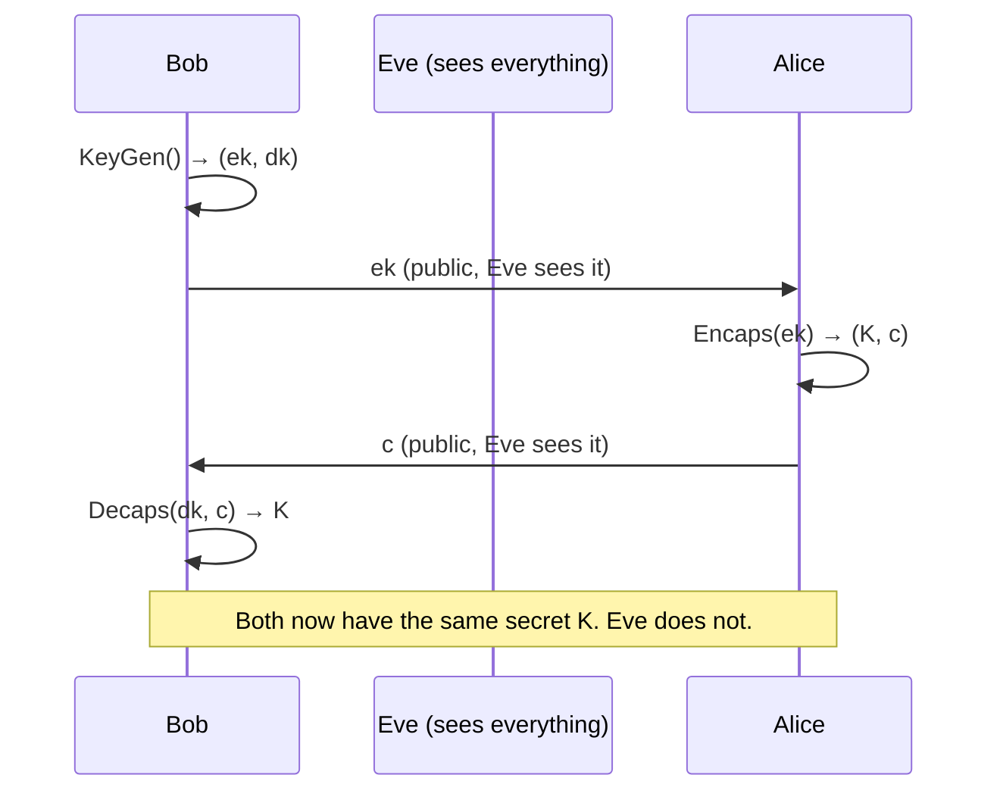
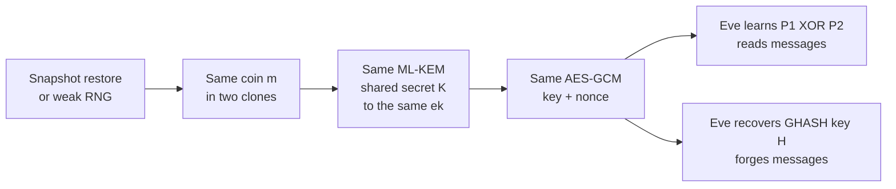
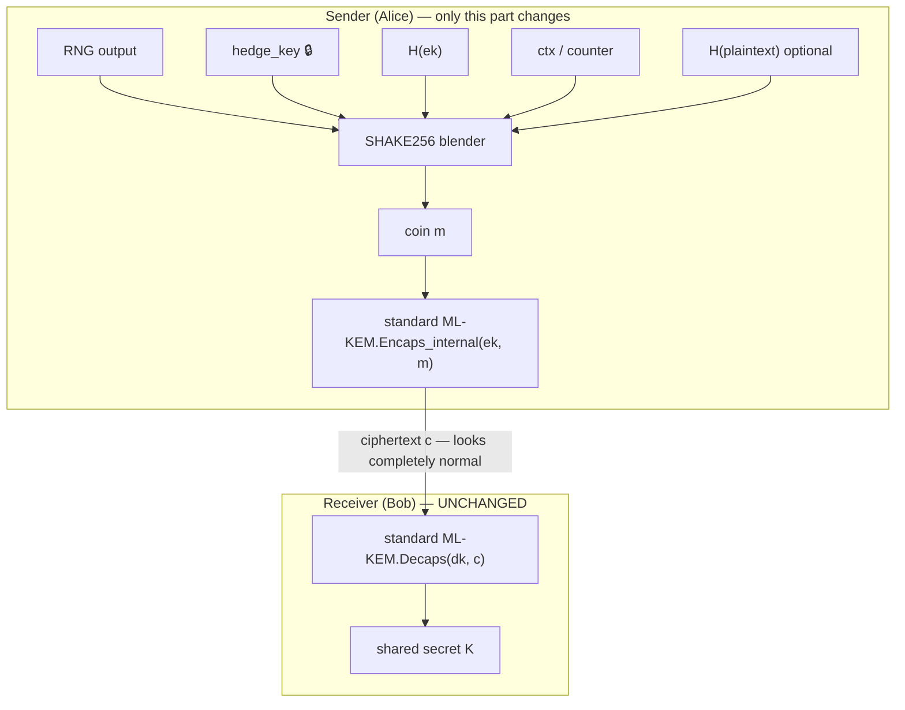

# HedgeKEM, Explained From Zero

### A complete beginner's guide to cryptography, quantum computers, ML-KEM, and our research idea

> **Who this is for:** someone at a 10th-grade level who knows basic algebra and has used a phone or laptop. You don't need to know any cryptography, quantum physics, or advanced math. Every new word is explained the first time it appears, and there is a glossary at the end.
>
> **How to read it:** go in order. Each part builds on the one before. If a part feels heavy, read its **"In one line"** summary and move on. You can come back later.
>
> **Where this ends:** by the last part you'll understand what our proposed IEEE paper ("HedgeKEM") is about, why it matters, why it's new, and exactly what experiments we plan to run. None of them needs special hardware.

---

## Table of Contents

- [Part 0 — The Story in 60 Seconds](#part-0--the-story-in-60-seconds)
- [Part 1 — What Is Cryptography?](#part-1--what-is-cryptography)
- [Part 2 — Bits, Bytes, and How Computers See Secrets](#part-2--bits-bytes-and-how-computers-see-secrets)
- [Part 3 — Secret-Key Encryption (One Shared Key)](#part-3--secret-key-encryption-one-shared-key)
- [Part 4 — The Big Problem: How Do Two Strangers Agree on a Key?](#part-4--the-big-problem-how-do-two-strangers-agree-on-a-key)
- [Part 5 — Public-Key Cryptography: The Magic Padlock](#part-5--public-key-cryptography-the-magic-padlock)
- [Part 6 — Hard Problems: Why Crypto Works at All](#part-6--hard-problems-why-crypto-works-at-all)
- [Part 7 — Quantum Computers, Without the Hype](#part-7--quantum-computers-without-the-hype)
- [Part 8 — Post-Quantum Cryptography (PQC)](#part-8--post-quantum-cryptography-pqc)
- [Part 9 — Lattices and "Learning With Errors"](#part-9--lattices-and-learning-with-errors)
- [Part 10 — What Is a KEM?](#part-10--what-is-a-kem)
- [Part 11 — Inside ML-KEM, Step by Step](#part-11--inside-ml-kem-step-by-step)
- [Part 12 — Where ML-KEM Is Used Today](#part-12--where-ml-kem-is-used-today)
- [Part 13 — Randomness: The Hidden Foundation](#part-13--randomness-the-hidden-foundation)
- [Part 14 — When Randomness Breaks: A History of Disasters](#part-14--when-randomness-breaks-a-history-of-disasters)
- [Part 15 — The Pain Point: In ML-KEM, One Random Number Is Everything](#part-15--the-pain-point-in-ml-kem-one-random-number-is-everything)
- [Part 16 — Clones: Virtual Machines, Snapshots, and Serverless](#part-16--clones-virtual-machines-snapshots-and-serverless)
- [Part 17 — The Domino Effect: Nonce Reuse in AES-GCM](#part-17--the-domino-effect-nonce-reuse-in-aes-gcm)
- [Part 18 — Why the "Hybrid" Doesn't Save Us](#part-18--why-the-hybrid-doesnt-save-us)
- [Part 19 — Our Idea: HedgeKEM](#part-19--our-idea-hedgekem)
- [Part 20 — Why HedgeKEM Works: The Guarantees](#part-20--why-hedgekem-works-the-guarantees)
- [Part 21 — What HedgeKEM Can't Do (Being Honest)](#part-21--what-hedgekem-cant-do-being-honest)
- [Part 22 — Is This Really New? (Related Work)](#part-22--is-this-really-new-related-work)
- [Part 23 — The Research Plan: Experiments](#part-23--the-research-plan-experiments)
- [Part 24 — What the Paper Will Look Like](#part-24--what-the-paper-will-look-like)
- [Part 25 — Risks and How We Handle Them](#part-25--risks-and-how-we-handle-them)
- [Part 26 — Recap: The Whole Journey on One Page](#part-26--recap-the-whole-journey-on-one-page)
- [Glossary](#glossary)
- [Further Reading](#further-reading)

---

## Part 0 — The Story in 60 Seconds

Imagine you and a friend want to share a secret password over the internet. Everyone can see everything you send. Computer scientists invented clever math, called *cryptography*, that lets you do this safely.

The math that protects almost all internet traffic today (RSA, elliptic curves) will be breakable by a big enough **quantum computer**. Nobody has built one that big yet. But attackers can **record** your encrypted messages today and decrypt them later. So the world is switching to new "quantum-safe" math. The most important new standard is called **ML-KEM**, published by the US government's standards body (NIST) in 2024.

ML-KEM is strong, but it has a weak spot. Every time it is used, the computer picks a **random number** called `m`. If an attacker can guess `m`, they get the secret. All the fancy quantum-safe math doesn't help at that point.

Computers are surprisingly bad at being random in some situations:
- right after a small device boots up;
- when a virtual computer is **cloned** from a saved snapshot, which happens constantly in cloud computing.

**Our idea, HedgeKEM:** instead of trusting the random number alone, mix it with other things the sender knows, using a hash function (a "blender" for data). Now the result is safe if *either* the randomness is good *or* the sender's private mixing key is secret. The receiver doesn't need to change anything, so it works with every existing ML-KEM system.

The paper will:
1. show the danger with real experiments;
2. design HedgeKEM;
3. explain why it's secure;
4. measure that it's fast and compatible.

The rest of this document explains each of those sentences properly.

---

## Part 1 — What Is Cryptography?

**In one line:** cryptography is the science of keeping information secret and trustworthy when enemies can see or change it.

### 1.1 The cast of characters

Cryptographers always tell stories with the same characters:

| Name | Role |
|---|---|
| **Alice** | wants to send a secret |
| **Bob** | wants to receive it |
| **Eve** | an *eavesdropper* who can read everything sent between Alice and Bob |
| **Mallory** | a *malicious* attacker who can also change, block, or fake messages |

The internet is a place where Eve and Mallory are always present. Your Wi-Fi router, your internet provider, the cables under the ocean, and the servers along the way could all be watching.

### 1.2 What cryptography gives us

1. **Confidentiality.** Eve can't read the message.
2. **Integrity.** Mallory can't change the message without being noticed.
3. **Authentication.** Bob can be sure the message really came from Alice.

This document is mostly about **confidentiality**: making sure Alice and Bob end up with a shared secret that Eve doesn't know.

### 1.3 A very old example: Caesar's cipher

Julius Caesar shifted every letter forward by 3:

```
Plain:  A B C D E F G H I J K L M N O P Q R S T U V W X Y Z
Cipher: D E F G H I J K L M N O P Q R S T U V W X Y Z A B C

HELLO  →  KHOOR
```

- The message `HELLO` is the **plaintext**.
- The scrambled `KHOOR` is the **ciphertext**.
- The number `3` is the **key**.
- Scrambling is **encryption**; unscrambling is **decryption**.

This cipher is terrible. There are only 25 possible keys, so Eve can just try them all. Trying every possible key is called a **brute-force attack**. Remember this idea; it comes back in a big way in Part 15.

> **Lesson 1:** a cipher is only as strong as the number of keys an attacker would have to try. Caesar had 25. Modern ciphers have more keys than there are atoms in the universe.

### 1.4 Kerckhoffs's principle

In the 1880s, Auguste Kerckhoffs said:

> *A system should be secure even if everything about it, except the key, is public.*

This is why modern crypto algorithms like ML-KEM are **published openly**. Everyone, including attackers, knows exactly how they work. All the security lives in the **key**, and keys come from **randomness**. That's why randomness is the main character of our paper.

---

## Part 2 — Bits, Bytes, and How Computers See Secrets

**In one line:** computers store everything as 0s and 1s, and the number of possible secrets doubles with every extra bit.

### 2.1 Bits and bytes

- A **bit** is a single 0 or 1.
- A **byte** is 8 bits, like `01101001`. One byte has 2⁸ = 256 possible values.
- Keys in modern crypto are usually **32 bytes = 256 bits**.

### 2.2 Why "number of bits" means "strength"

If a key is chosen uniformly at random from n bits, there are 2ⁿ possible keys:

| Bits | Number of possible keys | How long to try them all (at 1 billion tries/second) |
|---|---|---|
| 8 | 256 | instantly |
| 20 | about 1 million | 1 millisecond |
| 32 | about 4.3 billion | about 4 seconds |
| 40 | about 1.1 trillion | about 18 minutes |
| 64 | about 1.8 × 10¹⁹ | about 585 years |
| 128 | about 3.4 × 10³⁸ | about 10²² years (the universe is about 1.4 × 10¹⁰ years old) |
| 256 | about 1.2 × 10⁷⁷ | about the number of atoms in the universe; forget it |

So **128 bits or more is "unbreakable by brute force."** **32 bits is breakable on a laptop.**

Important twist: the number of bits in a key's *storage* is not what matters. What matters is how many bits of **real unpredictability** went into choosing it. A 256-bit key computed from a 32-bit guessable seed has only 32 bits of real strength. The name for "bits of real unpredictability" is **entropy**. Part 13 explains it properly.

### 2.3 XOR: the most important operation in crypto

**XOR** (written ⊕) compares two bits:

| a | b | a ⊕ b |
|---|---|---|
| 0 | 0 | 0 |
| 0 | 1 | 1 |
| 1 | 0 | 1 |
| 1 | 1 | 0 |

Rule: "1 if they are different, 0 if they are the same."

Magic property: **XOR-ing twice with the same thing undoes it.**

```
  1010   (message)
⊕ 0110   (key)
= 1100   (ciphertext)

  1100   (ciphertext)
⊕ 0110   (same key)
= 1010   (message is back!)
```

This is the heart of most real encryption. Keep it in mind for Part 17, where XOR becomes the attacker's weapon.

### 2.4 Hash functions: the data blender

A **hash function** takes any input (a word, a movie, a whole hard drive) and produces a short fixed-size "fingerprint." For example, 32 bytes.

Properties of a good hash:
1. **Deterministic.** Same input gives the same output, always.
2. **Avalanche effect.** Change one letter of the input and the output looks completely different.
3. **One-way.** From the output, you can't work backwards to the input.
4. **Collision-resistant.** It's practically impossible to find two inputs with the same output.

Example idea (not real outputs):
```
hash("hello")  → 2cf24d...
hash("hellp")  → 9a1f03...   (totally different)
```

Think of a hash like a **smoothie blender**. You can throw in strawberries, bananas, and a secret ingredient. You get a smoothie, but nobody can un-blend it to see exactly what went in. If even one ingredient is secret, nobody can predict the smoothie's exact taste.

ML-KEM uses a family of hash functions called **SHA-3**, including variants named **SHA3-256**, **SHA3-512**, **SHAKE128**, and **SHAKE256**. SHAKE is special: it can produce output of *any* length you ask for.

> **Our whole idea, HedgeKEM, is basically: put more ingredients into the blender before choosing the random number.** Hold that thought until Part 19.

---

## Part 3 — Secret-Key Encryption (One Shared Key)

**In one line:** if Alice and Bob already share a secret key, encrypting messages is a solved problem.

### 3.1 Symmetric encryption

**Symmetric** means both sides use the **same key**: one key locks, the same key unlocks.

The world standard is **AES** (Advanced Encryption Standard), chosen in 2001. It's extremely fast; your phone does it billions of times a day. With a 256-bit key, AES is considered safe even against quantum computers (Part 7 explains why).

### 3.2 Keystreams

Most modern encryption works like this:

1. From the key (and a number called a **nonce**, explained next), produce a long stream of random-looking bits called a **keystream**.
2. XOR the message with the keystream.

```
message:    H  E  L  L  O ...
keystream:  ⊕  ⊕  ⊕  ⊕  ⊕ ...   (random-looking bits made from key + nonce)
ciphertext: random-looking garbage
```

### 3.3 The nonce: "number used once"

A **nonce** is a number that must **never be repeated with the same key**. It makes sure that even if you send the same message twice, the ciphertexts look different, and that the keystream is never reused.

> 🚨 **The one sacred rule:** never use the same (key, nonce) pair twice. If you do, the same keystream gets reused, and Part 17 shows how badly that breaks things.

### 3.4 AES-GCM

**AES-GCM** is the most popular way to use AES. It does two things:
- **Encryption** (confidentiality), using a keystream.
- **Authentication** (integrity), using a mathematical "seal" called a **tag**, computed with a hidden internal value called the **authentication key H**.

If anyone modifies the ciphertext, the tag check fails and the receiver rejects the message. AES-GCM is used in TLS (the "padlock" in your browser), in HPKE, and in many other places. It is very safe when nonces are never repeated, and very fragile when they are.

---

## Part 4 — The Big Problem: How Do Two Strangers Agree on a Key?

**In one line:** symmetric encryption needs a shared key, but strangers on the internet have never met to share one.

You visit `bank.com` for the first time. Your browser and the bank's server have never met, and Eve is watching everything. How do they agree on an AES key without Eve learning it?

You can't just send the key; Eve would see it. You can't meet in person; there are billions of websites.

This is called the **key distribution problem**. For thousands of years it had no good solution. Armies used couriers carrying codebooks. Then, in the 1970s, came one of the most beautiful ideas in mathematics.

---

## Part 5 — Public-Key Cryptography: The Magic Padlock

**In one line:** use two different keys, a public one that anyone can have for locking and a private one only you have for unlocking.

### 5.1 The padlock analogy

1. Bob buys a padlock. He keeps the **only key** to it.
2. Bob mails **open padlocks** to anyone who asks. Eve can get one too; that's fine.
3. Alice puts her secret in a box, snaps Bob's open padlock shut on it, and sends the box.
4. Only Bob, with his private key, can open it. Eve has a padlock too, but a padlock can't *open* anything.

In crypto terms:
- The **open padlock** is Bob's **public key**. Share it with the world.
- The **key to the padlock** is Bob's **private key** (or **secret key**). Never share it.

This is called **asymmetric** or **public-key** cryptography.

### 5.2 Diffie–Hellman: mixing paint

In 1976, Whitfield Diffie and Martin Hellman found a way for two people to create a shared secret in public. The famous analogy uses paint:

```
        Alice                       public                     Bob
   secret color: red          common color: yellow       secret color: blue

   yellow + red = orange  ──── orange ────►
                          ◄─── green  ─────  yellow + blue = green

   green + red                                         orange + blue
     = brown                                              = brown
```

Both end up with the same **brown** (yellow + red + blue). Eve saw yellow, orange, and green. But "un-mixing" paint to find red or blue is practically impossible, so Eve can't make brown.

### 5.3 The real math (tiny numbers)

Instead of paint, Diffie–Hellman uses "clock arithmetic" (**modular arithmetic**). `x mod 23` means "the remainder after dividing by 23," like a clock with 23 hours.

- Public: prime `p = 23`, base `g = 5`.
- Alice picks secret `a = 4` and sends `A = 5⁴ mod 23 = 625 mod 23 = 4`.
- Bob picks secret `b = 3` and sends `B = 5³ mod 23 = 125 mod 23 = 10`.
- Alice computes `B^a = 10⁴ mod 23 = 18`.
- Bob computes `A^b = 4³ mod 23 = 64 mod 23 = 18`.
- **Shared secret = 18.** Eve saw 23, 5, 4, and 10.

With huge numbers (hundreds of digits), going backwards from `A` to `a` is believed impossible for normal computers. This problem is called the **discrete logarithm problem**.

Notice where the safety comes from: **Alice's secret `a` and Bob's secret `b` must be chosen randomly.** If Eve can guess `a`, she can compute the shared secret herself. Same lesson as Caesar: randomness is everything.

### 5.4 Today's versions: RSA and elliptic curves

- **RSA (1977):** safety rests on the fact that **multiplying** two huge primes is easy, but **factoring** the product back into the primes is very hard.
- **Elliptic-curve cryptography (ECC):** a fancier, more efficient version of Diffie–Hellman on a curve. **X25519** is the most popular elliptic-curve key exchange on the internet today.

Nearly every secure connection you've made in your life used RSA or elliptic curves. And all of them have the same weakness...

---

## Part 6 — Hard Problems: Why Crypto Works at All

**In one line:** all public-key crypto rests on math puzzles that are easy one way and hard the other way.

| System | Easy direction | Hard direction (the "trapdoor") |
|---|---|---|
| RSA | multiply two primes | factor the product |
| Diffie–Hellman / ECC | compute gᵃ | find a from gᵃ (discrete log) |
| ML-KEM (Part 9) | multiply a matrix and add small noise | remove the noise to find the secret |

"Hard" here means: **the best known methods for normal computers would take longer than the age of the universe**. Nobody has *proven* these problems are hard. We believe it because the smartest mathematicians have tried for decades and failed.

Then in 1994 a mathematician named Peter Shor showed that a different kind of computer could solve two of these three puzzles easily.

---

## Part 7 — Quantum Computers, Without the Hype

**In one line:** a large quantum computer could break RSA and elliptic curves, so we need new math, and we need it before such a computer exists.

### 7.1 Normal bits vs. qubits

A normal bit is **either 0 or 1**, like a coin lying on a table showing heads or tails.

A **qubit** (quantum bit) can be in a **superposition**, a mix of 0 and 1 at the same time, like a coin **spinning in the air**. When you **measure** it (catch the coin), it becomes a definite 0 or 1, randomly, with probabilities set by the mix.

(Your scholar's reference paper uses exactly this effect, measuring qubits in superposition, to generate *true random numbers*. That's a nice connection to our topic: randomness.)

### 7.2 Why that's powerful (sometimes)

With n qubits you can hold a superposition over 2ⁿ values at once. That doesn't mean quantum computers "try every answer in parallel and pick the right one." When you measure, you get just **one** random result. The trick is **interference**: carefully designed quantum algorithms make wrong answers cancel out (like waves canceling) and right answers reinforce, so that when you measure, you likely get something useful.

This works only for problems with special hidden structure. Two famous algorithms:

**Shor's algorithm (1994):**
- Efficiently factors numbers and solves discrete logs.
- **Breaks RSA, Diffie–Hellman, and elliptic curves completely.**
- Needs a large, error-corrected quantum computer. Recent estimates (for example, Craig Gidney's 2025 work) suggest RSA-2048 might fall to a machine with **fewer than a million noisy qubits**. Today's machines have only hundreds to a few thousand, and they're very error-prone. Experts disagree about when we'll get there, with guesses ranging from about 10 to 20+ years.

**Grover's algorithm (1996):**
- Speeds up brute-force *search*, but only by a square root. Searching 2¹²⁸ possibilities takes about 2⁶⁴ quantum steps.
- Simple fix: use bigger keys. **AES-256 stays safe.** Hash functions like SHA-3 stay safe too.

### 7.3 "Harvest now, decrypt later"

Here's why we can't just wait:

```
2026: Eve records your encrypted medical records / bank traffic / chats.
       (She can't read them yet. She stores them on cheap hard drives.)
  ...
2040: Eve gets access to a big quantum computer.
       She runs Shor's algorithm on the old recorded key exchange,
       recovers the keys, and reads everything from 2026.
```

Secrets that need to stay secret for 10+ years (health data, government secrets, trade secrets) are **already at risk today**. That's why the world started migrating in 2023–2025.

### 7.4 Summary table

| Crypto | Against normal computers | Against big quantum computers |
|---|---|---|
| RSA, Diffie–Hellman, ECC (X25519) | safe | **broken** (Shor) |
| AES-256, SHA-3 | safe | safe (Grover only halves the bits) |
| **ML-KEM** | safe | **believed safe** |

---

## Part 8 — Post-Quantum Cryptography (PQC)

**In one line:** PQC means new public-key algorithms that run on normal computers but resist quantum attacks.

A common confusion: **post-quantum cryptography does not use quantum computers.** It's ordinary math running on your ordinary laptop or phone. It's just based on puzzles that quantum computers *can't* solve easily, as far as we know.

(This is different from **quantum cryptography**, such as QKD and QRNG, which uses actual quantum hardware. Your scholar's paper is in that area. Ours is in PQC.)

### 8.1 NIST's worldwide competition

In 2016, **NIST** (the US National Institute of Standards and Technology, which sets standards used worldwide) launched an open competition. Cryptographers around the world submitted 82 candidate algorithms. For about 8 years, everyone tried to break everyone else's. Several candidates were broken along the way. One, called SIKE, was broken in 2022 by a classical laptop in about an hour!

In **August 2024**, NIST published the winners as official standards:

| Standard | Name | Purpose | Based on |
|---|---|---|---|
| **FIPS 203** | **ML-KEM** (formerly "CRYSTALS-Kyber") | key exchange (agreeing on a secret key) | lattices |
| FIPS 204 | ML-DSA (formerly "Dilithium") | digital signatures | lattices |
| FIPS 205 | SLH-DSA (formerly "SPHINCS+") | digital signatures | hash functions |

In 2025, NIST also picked **HQC** as a backup key-exchange algorithm based on different math, just in case lattices ever fail.

**"ML-KEM"** stands for **Module-Lattice-based Key-Encapsulation Mechanism**. By the end of Part 11 you'll understand every word in that name.

---

## Part 9 — Lattices and "Learning With Errors"

**In one line:** ML-KEM hides a secret inside equations that have small random "errors" added, and those errors make the equations nearly impossible to solve.

### 9.1 What is a lattice?

Take a sheet of graph paper. The points where lines cross form a **lattice**: a regular grid of points. Now tilt and stretch the grid with some strange directions. It's still a lattice.

```
 •     •     •     •
    •     •     •     •
 •     •     •     •
    •     •     •     •        ← a "skewed" 2-D lattice
```

A classic hard problem: **given a random point in space, find the closest lattice point.** In 2 dimensions that's easy; you can see it. In **hundreds of dimensions** (ML-KEM-768 effectively works in 768 dimensions) with a badly skewed grid, it's believed to be extremely hard, even for quantum computers.

You don't need to picture 768 dimensions. You just need the algebra version, which is called **Learning With Errors**.

### 9.2 First, equations WITHOUT errors are easy

Suppose a secret is two numbers `s = (s₁, s₂)`. I tell you:

```
 3·s₁ + 2·s₂ = 31
 1·s₁ + 4·s₂ = 37
```

That's just a school system of equations. Solve it and you get `s₁ = 5, s₂ = 8`. Easy! Computers can do this instantly even for thousands of unknowns, using a method called Gaussian elimination.

### 9.3 Now add small errors

What if every answer is **slightly wrong**, off by a small random number like −2, −1, 0, +1, or +2?

```
 3·s₁ + 2·s₂ ≈ 32   (true value 31, error +1)
 1·s₁ + 4·s₂ ≈ 35   (true value 37, error −2)
```

With 2 unknowns you could still guess. But with hundreds of unknowns, and all arithmetic done "on a clock" (mod q, so numbers wrap around), the small errors spread through Gaussian elimination and **blow up into total garbage**. Nobody knows an efficient way to recover the secret. Not with normal computers, and not with quantum ones.

This puzzle is called **Learning With Errors (LWE)**. It was introduced by Oded Regev in 2005, and he later won the Gödel Prize for it.

> **LWE in one sentence:** given many "noisy" equations `b = A·s + e (mod q)`, where `A` is public and random, `s` is secret, and `e` is small random noise, find `s`. This is believed to be hard.

### 9.4 A toy encryption with LWE (real numbers you can check)

Let's encrypt **one bit** using LWE. All arithmetic is **mod 97** (a clock with 97 hours).

**Bob's key generation:**

- Secret key: `s = (5, 12)`.
- Public random rows `A`, plus small secret errors `e`:

| Row | a (public) | exact a·s mod 97 | error e (secret) | b = a·s + e mod 97 (public) |
|---|---|---|---|---|
| 1 | (10, 33) | 58 | +1 | **59** |
| 2 | (41, 7) | 95 | −1 | **94** |
| 3 | (22, 60) | 54 | +2 | **56** |
| 4 | (8, 71) | 19 | −2 | **17** |

Bob's **public key** is the rows `a` together with the values `b`. His **secret key** is `s`. Eve sees all the `a`s and `b`s, but because of the hidden errors she can't solve for `s`. (With these tiny numbers she could, of course. With real sizes she can't.)

**Alice encrypts the bit 0.** She secretly picks a random subset of rows, say rows {1, 3}, and adds them up:
- `u = a₁ + a₃ = (10+22, 33+60) = (32, 93)`
- `v = b₁ + b₃ + (bit × 48) = 59 + 56 + 0 = 115 mod 97 = 18`
- She sends the ciphertext `(u, v) = ((32, 93), 18)`.

**Bob decrypts.** He computes `v − u·s mod 97`:
- `u·s = 32·5 + 93·12 = 160 + 1116 = 1276 mod 97 = 15`
- `18 − 15 = 3`

`3` is **close to 0** (not close to 48), so the bit is **0**. ✅

Why does that work? Because `v − u·s` equals exactly the sum of the errors of the chosen rows (`+1 + 2 = 3`) plus `bit × 48`. The errors are small, so Bob can tell "near 0" from "near 48."

**Alice encrypts the bit 1.** Subset {2, 3, 4}:
- `u = (41+22+8, 7+60+71) = (71, 138 mod 97) = (71, 41)`
- `v = 94 + 56 + 17 + 48 = 215 mod 97 = 21`
- Bob: `v − u·s = 21 − (71·5 + 41·12) = 21 − 847 mod 97 = 47`

`47` is close to 48, so the bit is **1**. ✅ (The errors summed to −1, so we got 48 − 1 = 47.)

**Key observations for later:**

1. **Alice's encryption used randomness:** her choice of subset. In real ML-KEM this randomness is generated from a seed.
2. If Eve **knew Alice's random choice** (the subset), she could compute `v` both ways (with bit = 0 and with bit = 1) and see which matches. **The randomness of the sender is part of the secret.** This is exactly the weak spot our paper studies.
3. Decryption works only because errors stay small. Very rarely, errors could add up too much and decryption fails. ML-KEM picks parameters so this happens with probability below about 2⁻¹³⁸, which is basically never.

### 9.5 From LWE to *Module*-LWE (the "M" in ML-KEM)

Real ML-KEM makes LWE efficient using two upgrades:

- **Polynomials instead of single numbers.** Each "number" is actually a polynomial with **256 coefficients**, like `c₀ + c₁x + c₂x² + … + c₂₅₅x²⁵⁵`, with every coefficient taken mod **q = 3329**. Multiplying polynomials mixes everything together nicely, and one polynomial does the work of 256 numbers.
- **Small matrices of polynomials** (a "module"). The public matrix `A` is a k × k grid of polynomials:
  - k = 2 for ML-KEM-512
  - k = 3 for ML-KEM-768 (the most used)
  - k = 4 for ML-KEM-1024

  So ML-KEM-768 effectively works with 3 × 256 = 768 hidden numbers. That's where the "768" comes from.

A clever trick called the **Number Theoretic Transform (NTT)**, a cousin of the Fast Fourier Transform, makes polynomial multiplication super fast. That's why ML-KEM runs in microseconds.

---

## Part 10 — What Is a KEM?

**In one line:** a KEM lets Alice create a fresh random secret and lock it in a box that only Bob can open.

### 10.1 Key exchange vs. key encapsulation

Diffie–Hellman is a symmetric "dance": both sides contribute equally. ML-KEM works differently, like sending a locked box:

1. **KeyGen (Bob):** Bob makes a key pair: a public **encapsulation key `ek`** (the open padlock) and a private **decapsulation key `dk`** (the padlock's key). He publishes `ek`.
2. **Encaps (Alice):** Alice uses `ek` to produce two things:
   - a **shared secret `K`** (32 random-looking bytes) that she keeps;
   - a **ciphertext `c`** (the locked box containing K) that she sends to Bob.
3. **Decaps (Bob):** Bob uses `dk` to open `c` and gets the **same `K`**.

Now Alice and Bob both have `K` and can use it as an AES key. Eve saw `ek` and `c`, but can't get `K`.



**KEM** = **Key Encapsulation Mechanism**. "Encapsulate" just means "wrap in a capsule."

### 10.2 The crucial detail: who picks K?

In ML-KEM, **Alice (the encapsulator) picks the randomness that determines K.** Bob just receives it. So if Alice's randomness is bad, `K` is bad, no matter how perfect Bob's keys are.

Keep that sentence in mind. It is the core of our paper.

---

## Part 11 — Inside ML-KEM, Step by Step

**In one line:** ML-KEM is LWE encryption of a random 32-byte value `m`, plus a clever "re-encrypt and check" safety trick, and the shared secret comes from hashing `m`.

We'll use the official names from FIPS 203. You don't need to memorize the formulas; follow the story.

### 11.1 The three sizes

| Parameter set | Security level (roughly like…) | Encapsulation key `ek` | Decapsulation key `dk` | Ciphertext `c` | Shared secret `K` |
|---|---|---|---|---|---|
| ML-KEM-512 | AES-128 | 800 bytes | 1,632 bytes | 768 bytes | 32 bytes |
| **ML-KEM-768** | AES-192 | **1,184 bytes** | **2,400 bytes** | **1,088 bytes** | **32 bytes** |
| ML-KEM-1024 | AES-256 | 1,568 bytes | 3,168 bytes | 1,568 bytes | 32 bytes |

For comparison, an X25519 public key is only 32 bytes. PQC keys are much bigger; that's the price of quantum safety.

The hash functions used inside:
- **H** = SHA3-256 (fingerprint of the public key)
- **G** = SHA3-512 (splits into two 32-byte outputs)
- **J** = SHAKE256 (used for the "fake key" in implicit rejection)

### 11.2 KeyGen (Bob)

```
1. Pick two random 32-byte seeds:  d  and  z.          ← RANDOMNESS #1
2. From d, derive:
     ρ (rho):    a public seed that expands into the big public matrix A
     σ (sigma):  a secret seed that expands into small secret s and small error e
3. Compute  t = A·s + e        (this is Module-LWE!)
4. ek = (t, ρ)                   ← public
   dk = (s, ek, H(ek), z)        ← private
```

**Fun fact:** the public matrix `A` isn't sent; only the 32-byte seed `ρ` is. Both sides regenerate `A` from `ρ` with SHAKE128. This saves a lot of space.

### 11.3 Encaps (Alice), the important one for us

```
1. Pick a random 32-byte value  m.                     ← RANDOMNESS #2 (THE COIN)
2. (K, r) = G( m ‖ H(ek) )         ‖ means "glue together"
      K = the shared secret (32 bytes)
      r = 32 bytes of "encryption randomness"
3. c = Encrypt(ek, m, r)            LWE encryption of m, using r for the noise
4. Output: keep K, send c.
```

Read step 2 again: **`K` is computed only from `m` and the public key `ek`.** And step 3: the ciphertext's randomness `r` also comes only from `m` and `ek`.

So **everything Alice produces is a fixed (deterministic) function of `m` and `ek`.** Since `ek` is public, **`m` is the only secret in the whole process.** Cryptographers call `m` the **coin**, as in "coin flips." This is the single most important fact in this document.

### 11.4 Decaps (Bob), and the clever safety check

```
1. m' = Decrypt(s, c)                 (recover the coin, like the toy example)
2. (K', r') = G( m' ‖ H(ek) )         (recompute what Alice computed)
3. c' = Encrypt(ek, m', r')           ← RE-ENCRYPT
4. if c' == c:  return K'             (everything checks out)
   else:        return J( z ‖ c )      (a "fake" random-looking key)
```

**Why re-encrypt?** It's called the **Fujisaki–Okamoto (FO) transform**. Mallory might send *fake, carefully crafted* ciphertexts to Bob and watch how Bob reacts, in order to slowly learn Bob's secret `s`. Re-encrypting lets Bob verify that `c` was built honestly. If not, Bob doesn't announce an error (that would leak information). He quietly returns a **fake key** made from his secret `z`. This is called **implicit rejection**. Mallory just sees a connection that doesn't work and learns nothing.

This makes ML-KEM **IND-CCA secure**: secure even when the attacker can send Bob any ciphertexts they like.

### 11.5 The hidden consequence of the FO trick

Because of the FO trick, **anyone who knows `m` can recompute `c` and check it.** Bob does this for safety. But so can Eve:

> If Eve has a short list of possible values of `m`, she can run `Encaps` with each guess and compare the result with the real ciphertext `c` she saw on the network. **The ciphertext is a perfect "guess checker."** When she finds a match, she knows `K`.

This isn't a flaw in ML-KEM when `m` is truly random: 2²⁵⁶ guesses is impossible. It only becomes a disaster when `m` **isn't** truly random. Part 15 is all about that.

### 11.6 A note on the old "hash the randomness" step

In the 2020 version of Kyber (Round 3 of the competition), Alice's step 1 was: pick random bytes, **then hash them** to get `m`. The idea was to avoid sending raw random-generator output into the algorithm. In the final **FIPS 203 (2024), NIST removed this hash**. Instead, they require that `m` come from an **approved random bit generator**. NIST's own presentation at the time listed "reintroduce hash of RNG output" among the public comments it considered.

Even the old hash wouldn't have helped against **low-entropy** randomness. Hashing a guessable value gives a guessable value, because Eve can hash her guesses too. Our HedgeKEM fixes this properly, by adding a **secret ingredient**.

---

## Part 12 — Where ML-KEM Is Used Today

**In one line:** ML-KEM already protects a large share of web traffic, plus messaging apps and remote logins.

- **Web browsing (TLS 1.3).** Chrome, Firefox, Edge, and Safari, plus Cloudflare, Google, and others, use a **hybrid** called **X25519MLKEM768**: they do X25519 *and* ML-KEM-768 together and combine the results. (Part 18 explains why hybrid, and why it doesn't solve our problem.)
  - In TLS, your **browser does KeyGen** (makes `ek`) and the **server does Encaps** (picks `m`).
- **Messaging.** Signal (its "PQXDH" protocol, 2023) and Apple iMessage ("PQ3", 2024) added Kyber/ML-KEM.
- **SSH (remote logins).** OpenSSH added a hybrid ML-KEM key exchange and made a post-quantum hybrid the default.
- **HPKE (Hybrid Public Key Encryption, RFC 9180).** A standard "encrypt a message to someone's public key" tool, used in things like Encrypted Client Hello and the MLS group-messaging protocol. Post-quantum versions using ML-KEM or **X-Wing** (an X25519 + ML-KEM-768 hybrid) are being standardized.
  - In HPKE, the **sender does Encaps to the recipient's long-term public key**. This detail matters a lot in Part 17.
- **VPNs, cloud key management, hardware security modules**, and many IoT devices are migrating now.

In short: **billions of ML-KEM encapsulations happen every day, on all kinds of machines**, including tiny devices and cloned cloud machines. Each one depends on a good random `m`.

---

## Part 13 — Randomness: The Hidden Foundation

**In one line:** computers are deterministic machines, so getting real randomness is hard. Most "random" numbers come from a small seed that's stretched out.

### 13.1 What "random" means in crypto

For crypto, "random" means **unpredictable to the attacker**, not just "looks messy." The digits of π look messy, but if you know I used digits of π, you can predict them all.

### 13.2 Entropy: measuring unpredictability

**Entropy** (measured in bits) = how many yes/no questions an attacker would need, on average, to guess the value.

- A fair coin flip has 1 bit of entropy.
- 256 fair coin flips have 256 bits.
- "The current time in seconds" seems random, but an attacker who knows roughly when you did something can guess it within a few thousand tries. That's only about **12 bits**.
- A process ID (a number the operating system gives each program) is often under 32,768, so about **15 bits**.

**The key rule:** a value is only as unpredictable as the **entropy that went into it**. Hashing, stretching, or encrypting a 20-bit-entropy seed gives you something that looks like 256 random bits, but **it can still be guessed in about 2²⁰ ≈ 1 million tries**.

### 13.3 How computers get randomness

```
 Physical noise sources                    Software stretching
 ─────────────────────                    ───────────────────
 • tiny timing jitter in hardware          Entropy pool (OS kernel)
 • mouse/keyboard/network timings   ──►         │
 • special hardware RNG circuits                ▼
   (Intel RDRAND, Apple Secure Enclave)   DRBG / CSPRNG  ──►  random bytes
 • (quantum RNGs, like your scholar's)   ("deterministic random   for apps
                                           bit generator")
```

1. **True random number generators (TRNGs)** measure physical noise. They're slow, but truly unpredictable.
2. That noise is collected into an **entropy pool** inside the operating system (Linux, macOS, Windows).
3. A **DRBG** (Deterministic Random Bit Generator), also called a **CSPRNG** (Cryptographically Secure Pseudo-Random Number Generator), takes a short truly random **seed** and stretches it into unlimited random-looking output, using AES or a hash.

The DRBG is **deterministic**: **same seed means the same output, forever.** That's fine as long as:
- the seed has enough entropy, and
- the seed (or the DRBG's internal state) is never duplicated or leaked.

### 13.4 Two places randomness lives

- **In the operating system kernel** (`/dev/urandom`, `getrandom()` on Linux).
- **Inside each program's memory.** For speed, many crypto libraries (for example OpenSSL) keep their **own DRBG state inside the program**. They seed it once from the OS, then generate many random numbers without asking the OS again.

That second point is innocent-looking, but it's a big deal in Part 16: **if a program's memory is copied, its DRBG state is copied too.**

---

## Part 14 — When Randomness Breaks: A History of Disasters

**In one line:** bad randomness has broken real systems again and again. It's one of the most common ways crypto fails in practice.

| Year | What happened | Why it matters to us |
|---|---|---|
| 2006–2008 | **Debian OpenSSL bug.** A code cleanup accidentally removed almost all entropy. The only remaining randomness was the process ID, so there were just **32,768 possible keys** for SSH/TLS on Debian/Ubuntu systems. All of them could be precomputed. | Software bug, so low entropy, so total break. |
| 2010 | **Sony PlayStation 3.** Sony's signing code reused the **same "random" number** for every signature. Hackers computed Sony's master private key. | Reused randomness, so total break. |
| 2010 | **Ristenpart & Yilek, "When Good Randomness Goes Bad."** Showed that **restoring a virtual machine from a snapshot** makes it reuse randomness, breaking TLS and exposing DSA signing keys. They proposed "hedging." | **The direct ancestor of our idea, but for old crypto.** |
| 2012 | **"Mining Your Ps and Qs"** (Heninger et al.). Scanning the internet showed that many routers and firewalls generated RSA keys **right after boot, with little entropy**, so many devices shared key parts. The researchers recovered the private keys of about 0.5% of TLS hosts. | **Low entropy at boot on small devices.** IoT is still like this. |
| 2013 | **Android SecureRandom bug.** Bitcoin wallet apps on Android produced repeated random numbers, and money was stolen. | Library-level RNG bug, real financial loss. |
| 2013 | **Dual_EC_DRBG.** A standardized random generator was widely believed to contain a **backdoor** that let its designer predict the output. | The RNG itself can be the attacker. |

**Pattern:** the main math (RSA, ECDSA) was never broken. **The randomness was.** ML-KEM's math is new and strong, but it depends on randomness just as much. Its exposure to these well-known failure modes **had not been studied or defended against**. That's our gap.

---

## Part 15 — The Pain Point: In ML-KEM, One Random Number Is Everything

**In one line:** if an attacker can narrow down `m` to a few billion possibilities, they can recover the shared secret on a laptop, and ML-KEM's math can't stop it.

### 15.1 The attack, step by step

Setup: Alice's device has a **weak random generator**. Say it effectively has only **32 bits of entropy** (for example, it booted seconds ago and seeded its DRBG from the clock and a counter).

```
Eve sees on the network:   ek (Bob's public key)   and   c (Alice's ciphertext)

for every possible seed guess g in 0 … 2³² − 1:
      m_guess      = what Alice's weak RNG would output for seed g
      (K_g, r_g)   = G( m_guess ‖ H(ek) )
      c_g          = Encrypt(ek, m_guess, r_g)
      if c_g == c:                      ← the ciphertext is the "guess checker"
            print("FOUND! Shared secret is", K_g)
            stop
```

Eve **never touches Bob's secret key**, and she **never solves any lattice problem**. She just runs ordinary ML-KEM encapsulation billions of times.

### 15.2 How long would it take?

Fast ML-KEM-768 code does one encapsulation in roughly **10–30 microseconds** on a modern CPU (we'll measure the exact number). Using 20 µs:

| Entropy in m | Guesses needed (worst case) | 1 CPU core | 14 cores (one ordinary high-end computer) |
|---|---|---|---|
| 20 bits | ~1 million | ~21 seconds | ~1.5 seconds |
| 32 bits | ~4.3 billion | ~24 hours | **~1.7 hours** |
| 40 bits | ~1.1 trillion | ~255 days | ~18 days (a small cloud cluster: hours) |
| 256 bits (proper) | 2²⁵⁶ | longer than the universe will exist | still impossible |

So a weak RNG with **32 bits** of entropy means **one ordinary computer recovers the key over lunch.** The attacker needs no supercomputer, no GPU farm, and no quantum computer. That cheapness is the point. Once Eve has `K`, she decrypts the whole session.

> 💡 **Is this "breaking ML-KEM"?** No, and we must say so clearly in the paper. ML-KEM's math is fine. The point is: **ML-KEM gives zero protection once the coin is guessable, and no deployed implementation adds any.** It inherits 100% of the weakness of whatever RNG is underneath.

### 15.3 Who is at risk?

- **IoT and embedded devices.** Cheap chips, no hardware RNG, generating keys seconds after boot. (Remember "Ps and Qs.")
- **Buggy or misconfigured software.** For example, a library built with a test RNG left on. A 2026 preprint by Tehrani, Buchanan, and Lemoudden showed that in six major ML-KEM libraries the coin can be reached or forced through internal interfaces or by swapping the RNG at build time.
- **Backdoored RNGs** (the Dual_EC lesson).
- **Cloned machines.** That's the next part.

---

## Part 16 — Clones: Virtual Machines, Snapshots, and Serverless

**In one line:** in modern cloud computing, computers are frequently copied, memory and all, and copies share the same "random" state.

### 16.1 Virtual machines and snapshots

A **virtual machine (VM)** is a whole computer simulated in software. Cloud providers like AWS, Azure, and Google Cloud run millions of them.

A **snapshot** saves a VM's **entire memory** to a file, like a "save game" in a video game. You can **restore** it later, or restore it **many times** to make many identical copies.

### 16.2 Serverless and "snapshot-start"

**Serverless** platforms (for example AWS Lambda) run small pieces of code on demand. Starting a program from scratch is slow, so newer features such as **AWS Lambda SnapStart**, built on Firecracker microVMs, work like this:

1. Start the program once and let it initialize (load libraries, set up crypto, and so on).
2. **Snapshot** it.
3. Every time a request comes in, **restore a copy** of that snapshot. This is very fast.

AWS's own documentation warns that anything random created during initialization will be **the same in every restored copy**, and it tells developers to be careful about uniqueness and randomness.

### 16.3 What gets cloned

```
          ┌──────────── Snapshot (one memory image) ────────────┐
          │  program code                                        │
          │  crypto library loaded                               │
          │  DRBG internal state  = S   ← "random" state frozen  │
          └──────────────────────────────────────────────────────┘
                     │ restore           │ restore           │ restore
                     ▼                   ▼                   ▼
                 Clone #1            Clone #2            Clone #3
              DRBG state = S      DRBG state = S      DRBG state = S
              next "random"       next "random"       next "random"
              = R                 = R                 = R      ← SAME!
```

The operating-system kernel can be told about the restore through a virtual device called **vmgenid** (VM Generation ID), which Linux supports. When it fires, Linux re-seeds its kernel RNG. But:
- **Not every hypervisor provides vmgenid.** For example, we don't yet know whether Apple's Virtualization framework does; we plan to test it.
- **Random state kept inside a program's memory** (Part 13.4) **isn't automatically re-seeded** unless the library specifically detects the restore. Some libraries added this; others haven't. AWS documents minimum library versions that are safe.
- **Timing gaps.** There can be a short window after restore before re-seeding happens.

### 16.4 Is a repeated `m` dangerous, if it's not predictable?

It depends on **who is encapsulating to whom**. Recall `K = G(m ‖ H(ek))`:

| Situation | Same `m` in two clones… | Result |
|---|---|---|
| **TLS**: server clones encapsulate to **different** browsers' fresh `ek`s | `ek` differs, so `K` differs | not immediately broken (but bad if `m` is also predictable) |
| **TLS**: client clones each do KeyGen with the same seed | identical key pairs | weak: one leak exposes all clones |
| **HPKE / Signal-style / static-key**: clones encapsulate to the **same** long-term `ek` | **same `K` and same `c` in two different sessions** | 🚨 **catastrophic**, see Part 17 |

---

## Part 17 — The Domino Effect: Nonce Reuse in AES-GCM

**In one line:** two clones that create the same `K` end up encrypting different messages with the same key and nonce, and that lets Eve read and forge messages.

### 17.1 How HPKE turns K into an AES key

In HPKE (base mode), after the KEM produces `K`, a "key schedule" derives:
- an **AES key**, and
- a **base nonce**.

Both are derived only from `K` (plus fixed public context info). The first message uses the base nonce directly.

So if two clones produce the same `K` for the same recipient, they get the **same AES key and the same nonce**. That breaks the sacred rule from Part 3.3.

### 17.2 Why reusing a keystream is fatal

Remember: ciphertext = message ⊕ keystream. If two different messages use the same keystream:

```
C₁ = P₁ ⊕ KS
C₂ = P₂ ⊕ KS
C₁ ⊕ C₂ = P₁ ⊕ KS ⊕ P₂ ⊕ KS = P₁ ⊕ P₂      (the keystream cancels out!)
```

Small example with 4-bit values:
```
P₁ = 1010,  KS = 0110  →  C₁ = 1100
P₂ = 0011,  KS = 0110  →  C₂ = 0101
C₁ ⊕ C₂ = 1001 = P₁ ⊕ P₂   ✓
```

Eve learns `P₁ ⊕ P₂` without knowing any key. Real messages (JSON, HTTP, English text) have lots of structure, so `P₁ ⊕ P₂` usually reveals **both messages**. And if Eve knows one message (say a standard header), she gets the other one completely.

### 17.3 It gets worse: forgery

AES-GCM's authentication tag (Part 3.4) relies on that hidden authentication key **H**. With two messages under the same key and nonce, Eve can set up a polynomial equation and **solve for H**. This is the well-known "forbidden attack" (Joux, 2006). With H, Eve can **forge** new messages that Bob will accept as genuine.

### 17.4 The full domino chain



One cloned memory snapshot, and a "quantum-safe" encrypted channel loses both **confidentiality** and **integrity**. This chain is one of the demonstrations planned for the paper.

---

## Part 18 — Why the "Hybrid" Doesn't Save Us

**In one line:** hybrids protect against broken math, not against a broken random generator.

Because ML-KEM is new, the industry plays it safe with **hybrids** like **X25519MLKEM768** and **X-Wing**:

```
shared secret = combine( X25519 secret , ML-KEM secret )
```

The logic: "if lattices turn out to be broken, X25519 still protects us (until quantum computers arrive); if quantum computers arrive, ML-KEM still protects us."

That's great protection against **math** failure. But both halves get their randomness from **the same RNG on the same machine**:
- weak RNG → the X25519 secret is guessable **and** the ML-KEM coin is guessable;
- cloned RNG → both repeat.

So a randomness failure breaks **both halves at the same time**. The hybrid gives **no extra protection** against the problem our paper addresses.

---

## Part 19 — Our Idea: HedgeKEM

**In one line:** don't use the random number directly. Blend it with other ingredients, including a secret one, so that `m` stays safe even if the RNG fails.

### 19.1 The word "hedge"

In everyday English, to **hedge a bet** means to protect yourself so you don't lose everything if one thing goes wrong. In cryptography, **hedging** means designing a system to **stay as secure as possible even when its randomness fails**. The idea goes back to Bellare and colleagues (2009), and to Ristenpart and Yilek (2010) for TLS. Modern signature standards use it: **ML-DSA's default "hedged" mode** mixes the private key and the message with fresh randomness.

**Nobody has designed, analyzed, or evaluated hedging for ML-KEM encapsulation.** That's our contribution.

### 19.2 The construction

Normal ML-KEM:
```
m = RNG(32 bytes)
```

HedgeKEM:
```
m = SHAKE256( "HedgeKEM-v1"          ← domain label (prevents mixing with other uses)
              ‖ RNG(32 bytes)          ← fresh randomness, as before
              ‖ H(ek)                  ← fingerprint of the recipient's public key
              ‖ ctx                    ← context: protocol name, session info, counter
              ‖ hedge_key              ← a 32-byte SECRET only the sender knows
              ‖ H(plaintext)           ← (optional) fingerprint of the message, when known
            )  → 32 bytes
```

Then **run normal ML-KEM Encaps with that `m`.** Everything after this line is standard FIPS 203.

Back to the smoothie blender from Part 2.4:

| Ingredient | Why it's in the blender |
|---|---|
| **RNG output** | When the RNG works, this alone makes `m` perfectly random, so nothing gets worse. |
| **hedge_key** (secret) | The **secret ingredient**. Even if the RNG output is totally predictable, Eve can't compute `m` without this. |
| **H(ek)** | Different recipients give different `m`, even if the RNG repeats. |
| **ctx / counter** | Different sessions or messages give different `m`, even with the same recipient. |
| **H(plaintext)** | Clones sending *different* messages get different `m`, which prevents the nonce-reuse disaster of Part 17. |
| **domain label** | Standard good practice: makes sure this hash can't be confused with any other hash use. |

### 19.3 Where does the `hedge_key` come from?

- Generated **once**, when the device or service is first set up, for example at the factory or at deployment. When there's time to gather strong entropy, or it can be injected from a trusted source.
- Stored like any other secret key (in secure storage, a TPM, a secure enclave, or a secrets manager).
- It can also be **derived from an existing secret** the device already has, such as its long-term private key (using a hash with a separate label).

Important: clones **share** the hedge_key. That's fine. It's still **secret from Eve**, and the other ingredients (ek, ctx, plaintext) make clones' outputs differ whenever their inputs differ.

### 19.4 The best part: the receiver doesn't change at all

Look at Decaps in Part 11.4. Bob recovers `m` from the ciphertext and re-encrypts. **He never checks *how* Alice chose `m`.** Any 32-byte `m` works.

So:
- ✅ Bob runs **completely unmodified ML-KEM**: OpenSSL, BoringSSL, Go, Apple, anything.
- ✅ The ciphertext looks exactly like a normal ML-KEM ciphertext. Nobody can tell the difference.
- ✅ No standards change, and no protocol change on the wire.
- ✅ Senders can adopt it **one at a time**, without coordinating with anyone.

That makes HedgeKEM **deployable today**, which reviewers care about a lot.

### 19.5 Cost

One extra SHAKE256 call on about 100–200 bytes of input. ML-KEM-768 encapsulation already does many SHA-3/SHAKE computations internally, so we expect the overhead to be **a few percent at most**. We will measure it exactly.

### 19.6 Visual summary



(FIPS 203 itself defines an internal function, `ML-KEM.Encaps_internal(ek, m)`, that takes `m` as an input. Official test vectors use it, and many libraries expose it as "derandomized" or "deterministic" encapsulation. So HedgeKEM can be built on top of existing libraries without rewriting ML-KEM.)

---

## Part 20 — Why HedgeKEM Works: The Guarantees

**In one line:** the coin is unpredictable if (the RNG is good) OR (the hedge_key is secret), and unique if (the RNG is good) OR (the inputs differ).

### 20.1 The two "OR" guarantees

We model SHAKE256 as an ideal "random oracle": a perfect blender whose output is completely unpredictable unless you know **every** input exactly. This is a standard assumption in crypto proofs, and ML-KEM's own security proof uses it.

**Guarantee 1, Unpredictability.**
> Eve can't predict `m` if **at least one** of these holds:
> - the RNG output has high entropy, **or**
> - the `hedge_key` is secret.

Reason: to predict the blender's output, Eve must know *all* the ingredients. Missing even one high-entropy ingredient makes the output look completely random to her.

**Guarantee 2, Uniqueness.**
> Two encapsulations produce the same `m` only if **all** ingredients are identical: same RNG output **and** same recipient **and** same context **and** same plaintext.

Reason: the blender gives different outputs for different inputs (collision resistance).

### 20.2 The scenario table (this will be a table in the paper)

| Scenario | Plain ML-KEM | HedgeKEM |
|---|---|---|
| RNG is perfect | ✅ secure | ✅ secure (never worse than plain) |
| RNG has low entropy (IoT boot, bug), hedge_key secret | ❌ **key recovered by brute force** | ✅ secure |
| RNG backdoored (attacker knows RNG output), hedge_key secret | ❌ **key known to attacker** | ✅ secure |
| Clones, encapsulating to **different** recipients | ⚠️ unique but possibly predictable | ✅ unique and unpredictable |
| Clones, **same** recipient, **different** messages (HPKE) | ❌ **same K → GCM nonce reuse → read and forge** | ✅ different `m` → no reuse |
| Clones, same recipient, **same** message | ❌ same K → leak | ⚠️ identical ciphertext: Eve only learns "the same message was sent twice" (the best possible; see Part 21) |
| RNG bad **and** hedge_key stolen | ❌ broken | ❌ broken (nothing can help here) |

### 20.3 The proof idea in plain words

The paper will include a short formal "game-based" proof. Here's the idea:

1. **Game 0:** the real world, with HedgeKEM using SHAKE256.
2. **Game 1:** replace SHAKE256 with a truly random function. Eve can only tell the difference if she queries the blender with the *exact* input, including the secret hedge_key (or the high-entropy RNG output). The chance of that is about (number of guesses) / 2²⁵⁶, which is negligible.
3. In Game 1, `m` is a perfectly random 32-byte value, which is **exactly what FIPS 203 assumes**. So ML-KEM's existing security proof (IND-CCA) applies directly.
4. Therefore: HedgeKEM is as secure as ML-KEM whenever either the RNG or the hedge_key is good.

(A full proof in the *quantum* random-oracle model, where the attacker can query hash functions in superposition, is more technical. We'll list it as future work and say so honestly.)

---

## Part 21 — What HedgeKEM Can't Do (Being Honest)

Good papers state their limits clearly. Reviewers trust you more for it.

1. **If the RNG is bad AND the hedge_key leaks, nothing helps.** All inputs would be known to Eve.
2. **Perfect clones sending the identical message to the identical recipient produce identical ciphertexts.** Eve learns "same message twice," and nothing else. This is the theoretical best any deterministic process can achieve (it's called "deterministic encryption security").
3. **It doesn't fix bad randomness in KeyGen** (Bob's seeds `d` and `z`). A similar hedge can be applied there, and we'll discuss it, but the main focus is Encaps.
4. **It doesn't replace good system hygiene.** vmgenid, re-seeding after restore, and certified RNGs are still the first line of defense. HedgeKEM is **defense-in-depth**: a safety net when those fail.
5. **FIPS 140-3 certification questions.** FIPS 203 says `m` must come from an approved random bit generator. We will argue that HedgeKEM's construction fits as "RBG output plus additional input," which is similar to how NIST's SP 800-90A allows extra inputs into DRBGs. But this is a **discussion point, not a guarantee**. Official certification is outside a student paper's scope.
6. **It doesn't defend against side-channel attacks** (measuring power use or timing to steal secrets). That's a different research area.

---

## Part 22 — Is This Really New? (Related Work)

We searched the research literature (October 2026) to check that the idea hasn't been published.

| Prior work | What it did | What it left open (our gap) |
|---|---|---|
| **Tehrani, Buchanan, Lemoudden — "On the Secrecy of the Encapsulation Coin in ML-KEM"** (IACR ePrint 2026/1117) | Showed the coin `m` can be reached or forced in six real libraries (OpenSSL 3.5, wolfSSL, AWS-LC, Go, Bouncy Castle, CIRCL) | **Attack side only.** Proposes no defense, and doesn't study snapshot cloning or low-entropy boot. *Our paper is the natural defensive follow-up.* |
| **Ristenpart & Yilek — "When Good Randomness Goes Bad"** (NDSS 2010) | VM-snapshot randomness reuse; hedging for classical TLS (RSA/DSA) | Pre-dates post-quantum crypto entirely |
| **Bellare et al. — Hedged public-key encryption** (2009); **Boldyreva, Patton, Shrimpton — "Hedging Public-Key Encryption in the Real World"** (CRYPTO 2017) | The theory of hedging | Never applied to ML-KEM or to post-quantum KEM + AES-GCM pipelines |
| **ML-DSA hedged signing** (FIPS 204) | Hedging for post-quantum *signatures* | No equivalent for the post-quantum *KEM* |
| **"Restoring Uniqueness in MicroVM Snapshots"** (arXiv 2102.12892); **AWS SnapStart docs**; **Linux vmgenid** | System-level fixes for snapshot randomness | Not cryptographic, and no post-quantum analysis |
| **FIPS 203 itself** | Requires `m` from an approved RNG; removed Kyber's hash of the RNG output | No defense if that requirement is violated in practice |

**Our novelty statement (draft):**

> *We present the first systematic analysis of randomness failures in ML-KEM deployments and propose HedgeKEM, the first hedged encapsulation for ML-KEM. HedgeKEM is wire-compatible with unmodified FIPS 203 decapsulation, provably preserves IND-CCA security when either the randomness source or a sender-held hedging key is uncompromised, and converts catastrophic snapshot-clone failures (shared-secret and AES-GCM nonce reuse) into at most equality leakage. We validate the threat with practical coin-recovery and snapshot-cloning experiments on commodity hardware, and show HedgeKEM costs a few percent of encapsulation time.*

(The numbers in brackets, like "a few percent," get replaced with our measured results.)

---

## Part 23 — The Research Plan: Experiments

**In one line:** the research is about ML-KEM, random generators, and cloud snapshot platforms, not about any particular computer. All experiments run on ordinary commodity hardware.

> **Hardware principle.** The subject of the paper is the *software and deployment* behavior: crypto libraries, operating systems, hypervisors, and serverless platforms. The machine we run on is only the **testbed**, and the paper treats it that way:
> - Results are reported in **hardware-neutral units**: encapsulations per core-second, and "core-hours" or approximate cloud cost to break a coin of a given entropy. Anyone can then scale them to their own machine or a rented cluster.
> - Everything is **cross-platform**: the attack and the HedgeKEM code are portable C/Python, built for both **x86-64** and **ARM64**.
> - The snapshot study targets the platforms that matter in the real world (**Linux KVM/QEMU, Firecracker/AWS Lambda**), not desktop hardware.
> - The testbed (the most powerful machine available to us is an Apple M4 Max laptop) is named once, in the "Experimental setup" paragraph, like any paper lists its test machine. It is not a contribution.
> - Low compute is actually a **feature of the story**: if a single affordable computer can recover a weak coin, the threat is real for every attacker.

### 23.1 Experiment 1: "How fast can a weak coin be cracked?"

- **What:** implement the brute-force attack from Part 15 against ML-KEM-768 (and the X25519MLKEM768 hybrid).
- **How:** use a fast open-source ML-KEM library (for example **mlkem-native** or **liboqs**, which have optimized code for both x86-64 and ARM64) through its "encapsulate with given `m`" function. Simulate RNGs with 20, 24, 28, 32, 36, and 40 bits of entropy. Parallelize across all CPU cores. If available, also run on a second, different machine (for example a college lab x86 PC or a free-tier cloud VM) to show the numbers carry over.
- **Measure:** guesses per core-second (hardware-neutral); time to recovery at each entropy level; extrapolated cost on rented cloud CPUs. Full 2³⁶–2⁴⁰ searches don't need to be completed: measure the rate on a sample and extrapolate, which is the standard method.
- **Output:** **Figure 1**, a line chart of "Entropy bits vs. time to recover the key" (log scale), with markers like "1 minute," "1 hour," "1 day."

### 23.2 Experiment 2: "Do real libraries repeat the coin after a snapshot?"

- **What:** run a tiny program that does ML-KEM encapsulation inside a **Linux VM**, snapshot it after the crypto library has initialized, restore it several times, and record each clone's `m`, `K`, and `c`.
- **Which libraries:** OpenSSL 3.5, AWS-LC, BoringSSL, Go's `crypto/mlkem`, liboqs, and RustCrypto `ml-kem`.
- **Which platforms:** the ones real deployments use:
  - **QEMU/KVM** on Linux (the basis of most clouds), with and without the vmgenid device turned on. This gives a clean "with protection vs. without" comparison.
  - **Firecracker** microVMs (the technology behind AWS Lambda), where KVM is available.
  - **AWS Lambda SnapStart** on the free tier, as a real-world check.
  - Desktop hypervisors (QEMU/UTM, Apple's Virtualization framework) as extra data points only.
- **Also check:** does the guest Linux kernel see a vmgenid event after restore on each platform? (For example, we couldn't find documentation saying whether Apple's framework provides it. Finding out is a small side result.)
- **Output:** **Table**, "Library × Platform → coin repeated? (Yes / No / Sometimes)." Any outcome is publishable: "all safe" is reassuring evidence, and "some repeat" is an important finding.

> ⚖️ **Ethics:** if we find a real vulnerability in a library, we report it privately to its maintainers first (**responsible disclosure**) and give them time to fix it before publishing. This is standard practice and makes the paper stronger.

### 23.3 Experiment 3: "The domino chain"

- **What:** build a small HPKE-style sender (ML-KEM-768 + HKDF + AES-GCM). Run two clones from one snapshot, each encrypting a different message to the same recipient.
- **Show:** identical keys and nonces; recover `P₁ ⊕ P₂`; recover the GCM authentication key and **forge a message the recipient accepts**.
- **Then:** repeat with HedgeKEM and show the attack fails (different `m`, different keys).
- **Output:** **Figure 2**, the domino chain diagram with real values, before and after.

### 23.4 Experiment 4: HedgeKEM evaluation

- **Correctness and compatibility:** HedgeKEM ciphertexts must be accepted by **unmodified** Decaps in all six libraries. **Table: interoperability matrix** (all ✅ is the goal).
- **Standards compatibility:** pass the official FIPS 203 / NIST ACVP test vectors through the `Encaps_internal` path.
- **Speed:** cycle counts or timings for KeyGen / Encaps / Decaps, with and without the hedge, for 512 / 768 / 1024. **Table: overhead %.**
- **Statistical sanity check:** run NIST SP 800-22 randomness tests on HedgeKEM's `m` values under a *zero-entropy* RNG plus a secret hedge_key, to show the output still looks random. (Your scholar's paper used NIST SP 800-22 too, so this is a nice familiar touch.)

### 23.5 Tools and resources

| Need | Tool | Cost |
|---|---|---|
| ML-KEM implementations | mlkem-native, liboqs, OpenSSL 3.5, Go, AWS-LC, BoringSSL, RustCrypto | free / open source |
| Virtual machines | QEMU/KVM, Firecracker (Linux); UTM / Apple Virtualization framework as extra data points | free |
| Analysis and plots | Python (numpy, matplotlib) | free |
| Randomness tests | NIST SP 800-22 test suite | free |
| Hardware | any modern multi-core computer (our testbed: an M4 Max laptop; a college lab PC or free-tier cloud VM as a second machine) | already available |
| Optional cloud | AWS free tier (Lambda SnapStart) | free tier |

No GPU cluster, no quantum computer, no special hardware.

### 23.6 Timeline (about 8–10 weeks)

| Week | Work |
|---|---|
| 1–2 | Read the key papers (Further Reading below). Set up libraries and VMs. Reproduce basic ML-KEM. |
| 3 | Experiment 1 (brute-force curve) |
| 4–5 | Experiment 2 (snapshot study across libraries and platforms) |
| 5–6 | Implement HedgeKEM; Experiment 3 (domino chain + fix) |
| 6–7 | Experiment 4 (interop, test vectors, speed, randomness tests); write the proof sketch |
| 8–10 | Write the paper, make the figures, get feedback, revise |

---

## Part 24 — What the Paper Will Look Like

IEEE conference papers are usually **6–8 pages, two-column**. A planned outline:

1. **Abstract**: problem, idea, results in about 200 words.
2. **Introduction**: harvest-now-decrypt-later → ML-KEM adoption → the coin is the only secret → randomness failures are common → our contributions (bullet list).
3. **Background**: ML-KEM (Encaps/Decaps, FO transform), RNGs/DRBGs, VM snapshots, HPKE + AES-GCM.
4. **Threat model and failure taxonomy**: 4 failure types × 3 usage modes, with a consequence table.
5. **Attacks in practice**: Experiment 1 (curve), Experiment 2 (library table), Experiment 3 (domino chain).
6. **HedgeKEM design**: construction, choice of ingredients, hedge_key management, KeyGen variant.
7. **Security analysis**: the two OR-guarantees with proof sketch; the scenario table.
8. **Evaluation**: interop matrix, test vectors, overhead, randomness tests.
9. **Discussion**: FIPS 140-3 considerations, limits (Part 21), deployment advice.
10. **Related work**: Part 22, written formally.
11. **Conclusion and future work**: quantum random-oracle proof, formal verification, hardware/IoT measurements, standardization proposal (for example an IETF/CFRG note).

**Possible title:**
> *HedgeKEM: Wire-Compatible Hedged Encapsulation for ML-KEM Against Randomness Failures in Snapshot-Restored and Entropy-Starved Deployments*

**Possible venues** (check each one's current call for papers and deadlines): IEEE TrustCom, IEEE CNS (Conference on Communications and Network Security), the security symposia at IEEE ICC or IEEE GLOBECOM, IEEE Quantum Week (QCE, which has a post-quantum cryptography track).

---

## Part 25 — Risks and How We Handle Them

| Risk | What a reviewer might say | Our answer |
|---|---|---|
| "Hedging is an old idea" | "Incremental: you just applied Bellare 2009 to ML-KEM." | The novelty is the **first ML-KEM-specific analysis and defense**, plus **new empirical evidence** (snapshot study, domino chain on post-quantum HPKE) and a **wire-compatible design**. Experiments 2 and 3 are what make it a full paper, so we must not skip them. |
| Libraries are already safe after restore | "So the problem doesn't exist." | The low-entropy and backdoored-RNG cases don't depend on snapshots, and documenting which libraries and platforms are safe is valuable on its own. |
| Proof only in the classical random-oracle model | "What about quantum attackers on the hash?" | State it clearly as a limitation; cite standard quantum random-oracle techniques; mark it as future work. |
| "This doesn't break ML-KEM" | "Overclaiming." | We never claim ML-KEM is broken. We say ML-KEM *inherits* RNG failures and that no deployed implementation hedges against them. |
| Ethics / disclosure | — | Responsible disclosure before submission. |
| "Results only hold on your machine" | "Your attack timings are specific to one laptop." | Report hardware-neutral rates (per core-second, cloud cost), use cross-platform code, and confirm on a second machine. The security claims (the proof, interop, and snapshot behavior) don't depend on hardware at all. |

---

## Part 26 — Recap: The Whole Journey on One Page

1. **Cryptography** keeps secrets safe from Eve. Security lives in **keys**, and keys come from **randomness**.
2. **Symmetric crypto** (AES) is fast but needs a shared key. **Nonces must never repeat.**
3. **Public-key crypto** (RSA, Diffie–Hellman, elliptic curves) lets strangers agree on keys.
4. **Quantum computers** running Shor's algorithm will break RSA and elliptic curves. **"Harvest now, decrypt later"** means we must switch now.
5. **Post-quantum crypto** uses new hard problems. NIST standardized **ML-KEM** in 2024, based on **Learning With Errors**: equations with small noise are very hard to solve.
6. ML-KEM is a **KEM**: Bob publishes `ek`, Alice runs **Encaps** to get `(K, c)`, and Bob runs **Decaps** on `c` to get `K`.
7. **Inside Encaps, everything comes from one 32-byte random coin `m`** (and the public `ek`). The **FO re-encryption check** means the ciphertext lets anyone verify a guess of `m`.
8. **Randomness fails in practice**: low entropy at boot, bugs, backdoors, and **cloned VMs and serverless snapshots**. History is full of such disasters.
9. **Weak coin** → brute force on a laptop → shared secret recovered. **Cloned coin** to the same recipient → same AES-GCM key and nonce → messages read **and** forged. The **hybrid** doesn't help, because both halves share the RNG.
10. **HedgeKEM:** `m = SHAKE256(label ‖ RNG ‖ H(ek) ‖ ctx ‖ hedge_key ‖ H(plaintext))`. Unpredictable if *RNG good OR hedge_key secret*; unique if *RNG good OR inputs differ*. **The receiver is unchanged**, so it works with every ML-KEM implementation today. The cost is about one extra hash.
11. **The paper:** taxonomy + attack experiments + snapshot study + HedgeKEM + proof sketch + interop and speed evaluation. All of it runs on **ordinary commodity hardware in about 8–10 weeks**. The computer is just the testbed, not part of the contribution.

---

## Glossary

| Term | Meaning |
|---|---|
| **AES** | The world-standard symmetric cipher. AES-256 is safe against quantum computers. |
| **AES-GCM** | A mode of AES that both encrypts and authenticates. Breaks badly if a (key, nonce) pair repeats. |
| **Asymmetric / public-key crypto** | Crypto with a public key (shareable) and a private key (secret). |
| **Authentication key H (GHASH key)** | The hidden value AES-GCM uses to compute tags. Leaks after nonce reuse, enabling forgeries. |
| **Bit / byte** | One 0-or-1 / eight bits. |
| **Brute force** | Trying every possible key or guess. |
| **Ciphertext** | The scrambled message. |
| **Coin (`m`)** | ML-KEM's 32-byte random value chosen during Encaps. The only secret in encapsulation. |
| **CSPRNG / DRBG** | A software random generator that stretches a short seed into lots of random-looking output. Deterministic: same seed, same output. |
| **Decaps** | Bob's step: open the ciphertext with the private key to get K. |
| **Diffie–Hellman** | The first public key-agreement method (1976). Broken by Shor's algorithm. |
| **Domain separation / label** | A fixed text prefix in a hash input so different uses can't be confused. |
| **ek / dk** | Encapsulation key (public) / decapsulation key (private) in ML-KEM. |
| **Encaps** | Alice's step: use the public key to create a shared secret K and ciphertext c. |
| **Entropy** | Bits of true unpredictability. |
| **FIPS 203** | The official US standard document defining ML-KEM (August 2024). |
| **FO transform (Fujisaki–Okamoto)** | ML-KEM's "re-encrypt and compare" safety check during Decaps. |
| **Grover's algorithm** | Quantum search. Speeds up brute force by a square root, so double the key size. |
| **Hash function** | A one-way "blender" that makes a fixed-size fingerprint of any input (SHA-3, SHAKE). |
| **Hedging** | Designing crypto to stay secure even when randomness fails. |
| **hedge_key** | In HedgeKEM, the sender's secret 32-byte "secret ingredient." |
| **HPKE** | Hybrid Public Key Encryption (RFC 9180): a standard way to encrypt a message to someone's public key using a KEM + AES-GCM. |
| **Hybrid (X25519MLKEM768, X-Wing)** | Using a classical and a post-quantum key exchange together. |
| **Implicit rejection** | When Decaps detects a bad ciphertext, it quietly returns a fake key instead of an error. |
| **IND-CCA** | The strong security goal ML-KEM meets: safe even if the attacker can ask for decapsulations of their own crafted ciphertexts. |
| **KEM** | Key Encapsulation Mechanism: KeyGen / Encaps / Decaps. |
| **Lattice** | A regular grid of points in many dimensions; the basis of ML-KEM's hardness. |
| **LWE / Module-LWE** | Learning With Errors: recovering a secret from noisy linear equations. "Module" means using small matrices of polynomials. |
| **ML-KEM** | Module-Lattice-based KEM: the NIST post-quantum key-exchange standard (from Kyber). |
| **mod q** | "Clock arithmetic": keep the remainder after dividing by q. ML-KEM uses q = 3329. |
| **Nonce** | "Number used once." Must never repeat with the same key. |
| **NTT** | Number Theoretic Transform: a fast trick for multiplying polynomials. |
| **Plaintext** | The readable original message. |
| **PQC** | Post-quantum cryptography: normal-computer algorithms that resist quantum attacks. |
| **Qubit / superposition** | Quantum bit / being in a mix of 0 and 1 until measured. |
| **Random oracle** | An idealized perfect hash function used in security proofs. |
| **Responsible disclosure** | Privately reporting a vulnerability to the developers before publishing. |
| **RNG / TRNG** | Random number generator / true (physical) random number generator. |
| **Seed** | The short starting randomness given to a DRBG. |
| **Shor's algorithm** | Quantum algorithm that breaks RSA and elliptic curves. |
| **Snapshot / restore** | Saving a VM's full memory and starting it again, possibly many times (clones). |
| **SnapStart / Firecracker** | AWS features/technology that start serverless functions from snapshots. |
| **Symmetric crypto** | The same key is used to lock and unlock (AES). |
| **TLS** | The protocol behind the browser padlock (HTTPS). |
| **vmgenid** | A virtual device that tells a guest OS "you were just restored/cloned," so it re-seeds randomness. |
| **X25519** | The popular elliptic-curve key exchange. Fast and small, but not quantum-safe. |
| **XOR (⊕)** | Bit operation: 1 if different, 0 if same. Applying it twice undoes it. |

---

## Further Reading

Start with the ones marked ⭐.

**Standards**
- ⭐ NIST, *FIPS 203: Module-Lattice-Based Key-Encapsulation Mechanism Standard* (2024): https://nvlpubs.nist.gov/nistpubs/fips/nist.fips.203.pdf
- NIST FIPS 203 update presentation (2024; shows the RNG-hash discussion): https://csrc.nist.gov/csrc/media/Presentations/2024/fips-203/images-media/dang-fips-203-pqc2024.pdf
- RFC 9180, *Hybrid Public Key Encryption (HPKE)*: https://www.rfc-editor.org/rfc/rfc9180
- X-Wing hybrid KEM draft: https://datatracker.ietf.org/doc/draft-connolly-cfrg-xwing-kem/
- ML-KEM for TLS 1.3 draft: https://www.ietf.org/archive/id/draft-ietf-tls-mlkem-02.html

**Closest research (must cite)**
- ⭐ Tehrani, Buchanan, Lemoudden, *On the Secrecy of the Encapsulation Coin in ML-KEM*, IACR ePrint 2026/1117: https://eprint.iacr.org/2026/1117
- ⭐ Ristenpart & Yilek, *When Good Randomness Goes Bad: Virtual Machine Reset Vulnerabilities and Hedging Deployed Cryptography*, NDSS 2010: https://pages.cs.wisc.edu/~rist/papers/sslhedge.pdf
- Boldyreva, Patton, Shrimpton, *Hedging Public-Key Encryption in the Real World*, CRYPTO 2017: https://eprint.iacr.org/2017/510
- Bellare et al., *Hedged Public-Key Encryption: How to Protect against Bad Randomness*, ASIACRYPT 2009.
- Heninger et al., *Mining Your Ps and Qs: Detection of Widespread Weak Keys in Network Devices*, USENIX Security 2012.

**Snapshots and cloud**
- AWS, *Handling uniqueness with Lambda SnapStart*: https://docs.aws.eu/lambda/latest/dg/snapstart-uniqueness.html
- *Restoring Uniqueness in MicroVM Snapshots* (arXiv 2102.12892): https://arxiv.org/pdf/2102.12892
- Linux vmgenid RNG-reseed patch discussion: https://lkml.iu.edu/hypermail/linux/kernel/2202.3/02048.html
- Apple Virtualization framework, `restoreMachineStateFrom`: https://developer.apple.com/documentation/virtualization/vzvirtualmachine/restoremachinestatefrom(url:completionhandler:)

**Learning the background (beginner friendly)**
- Oded Regev, *The Learning with Errors Problem* (survey): a clear introduction to LWE.
- Any introductory video on "Kyber / ML-KEM explained" and "Diffie–Hellman explained with paint" to reinforce Parts 5 and 9.
- Dan Boneh's free online course *Cryptography I* (Coursera/Stanford): the best general foundation.

---

*Document prepared as the explainer for the HedgeKEM IEEE conference paper proposal. All performance numbers marked as estimates (for example "~20 µs," "~1.7 hours") are back-of-the-envelope figures that the experiments in Part 23 will replace with measured values.*
