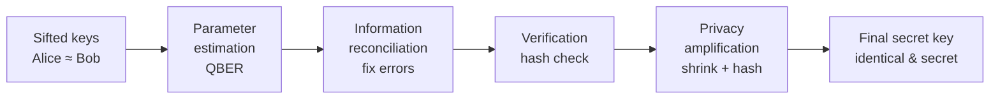
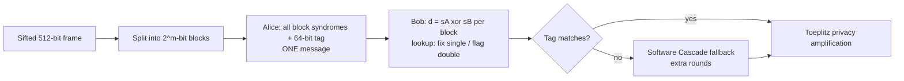
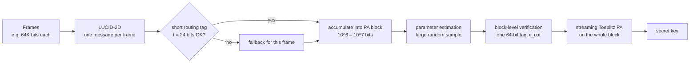

# LUCID-BB84, Explained From Zero — and the Contribution That Earns a Co-Author Seat

### A beginner's guide to quantum key distribution, error correction, and your friend's paper, plus a critique of it and a proposed contribution backed by simulations

> **Who this is for:** someone at a 10th-grade level who knows no quantum physics and no cryptography. Every term is explained when it first appears, and there is a glossary at the end.
>
> **Companion document:** [`HEDGEKEM_EXPLAINER.md`](HEDGEKEM_EXPLAINER.md) explains general cryptography basics (bits, XOR, keys, hashing, randomness) in more depth. This document recaps what it needs, so you can read it on its own.
>
> **How it's organized:**
> - **Parts 1–9** explain everything you need to understand the paper.
> - **Parts 10–12** explain the paper itself, section by section.
> - **Part 13** is an honest, detailed critique of the paper: strengths and gaps.
> - **Parts 14–18** are **your proposed contribution** (LUCID-2D plus a secure block-level pipeline), with simulation evidence, a work plan, and how it changes the paper.
> - **Part 19** covers how to pitch it to your friend.
>
> **Simulation scripts** behind the numbers in Parts 14–16 are in [`lucid_contribution_sims/`](lucid_contribution_sims/).

---

## Table of Contents

- [Part 0 — The Story in 60 Seconds](#part-0--the-story-in-60-seconds)
- [Part 1 — Secrets, Keys, and the One-Time Pad](#part-1--secrets-keys-and-the-one-time-pad)
- [Part 2 — Light, Photons, and Polarization](#part-2--light-photons-and-polarization)
- [Part 3 — The Quantum Rules That Make QKD Possible](#part-3--the-quantum-rules-that-make-qkd-possible)
- [Part 4 — The BB84 Protocol, Step by Step](#part-4--the-bb84-protocol-step-by-step)
- [Part 5 — Eve Attacks: Intercept-and-Resend and the QBER](#part-5--eve-attacks-intercept-and-resend-and-the-qber)
- [Part 6 — After the Photons: The Post-Processing Pipeline](#part-6--after-the-photons-the-post-processing-pipeline)
- [Part 7 — Information, Entropy, and the "Shannon Limit"](#part-7--information-entropy-and-the-shannon-limit)
- [Part 8 — Three Ways to Fix Errors: Cascade, LDPC, Hamming](#part-8--three-ways-to-fix-errors-cascade-ldpc-hamming)
- [Part 9 — Verification, Privacy Amplification, and Finite Keys](#part-9--verification-privacy-amplification-and-finite-keys)
- [Part 10 — Hardware Basics: FPGAs, RTL, Clock Cycles](#part-10--hardware-basics-fpgas-rtl-clock-cycles)
- [Part 11 — The LUCID-BB84 Paper, Section by Section](#part-11--the-lucid-bb84-paper-section-by-section)
- [Part 12 — What the Results Actually Say](#part-12--what-the-results-actually-say)
- [Part 13 — Critical Review: Strengths and Gaps](#part-13--critical-review-strengths-and-gaps)
- [Part 14 — The Contribution: LUCID-2D (Row-and-Column Syndrome Lookup)](#part-14--the-contribution-lucid-2d-row-and-column-syndrome-lookup)
- [Part 15 — Contribution 2: A Free QBER Meter From the Syndromes](#part-15--contribution-2-a-free-qber-meter-from-the-syndromes)
- [Part 16 — Contribution 3: A Security-Correct Block-Level Pipeline](#part-16--contribution-3-a-security-correct-block-level-pipeline)
- [Part 17 — Stretch Contribution: Hardware Synthesis](#part-17--stretch-contribution-hardware-synthesis)
- [Part 18 — How the Paper Changes, Work Plan, and Risks](#part-18--how-the-paper-changes-work-plan-and-risks)
- [Part 19 — Pitching It to Your Friend (and Why It Earns Co-Authorship)](#part-19--pitching-it-to-your-friend-and-why-it-earns-co-authorship)
- [Glossary](#glossary)
- [References](#references)

---

## Part 0 — The Story in 60 Seconds

Two parties, **Alice** and **Bob**, want a shared secret key. **Quantum key distribution (QKD)** lets them make one by sending single particles of light (photons) through a fiber. Physics guarantees that an eavesdropper, **Eve**, can't secretly measure the photons without disturbing them.

The photons are fragile, though. Bob's copy of the key ends up with a few **errors** (wrong bits). Before Alice and Bob can use the key, a classical computer pipeline must:
1. find and fix the errors (**reconciliation**),
2. check that the keys now match (**verification**),
3. squeeze out anything Eve might know (**privacy amplification**).

The standard error-fixing method, **Cascade**, needs many back-and-forth messages. On a network, each message costs a round-trip delay.

**Your friend's paper, LUCID-BB84**, proposes a hardware-friendly alternative. Fix errors with a tiny **lookup table** based on Hamming codes, in **one message**, and fall back to Cascade only when that fails. It's built in Python and Verilog (hardware). Results:
- **4–7× faster than Cascade** at very low error rates;
- **does not beat the modern one-message method (LDPC)** on key rate.

The paper honestly admits that its remaining selling point (small, low-power hardware) **was never measured**.

**Your contribution (proposed):**
1. **LUCID-2D.** Arrange the key in a grid and run the *same* lookup decoder along rows and then columns, repeating a few times. Our preliminary simulations show this:
   - turns LUCID into a **true one-message scheme** at low error rates (no fallback in ~97–100% of frames);
   - raises its key fraction from **0.79 → 0.93** at 0.1% errors;
   - beats every scheme in the paper's own comparison table at 0.1–0.5% error rates.
2. **A free error-rate meter** computed from data LUCID already sends. It's about **25× more accurate** than the paper's current method at 0.2% errors, and it costs zero extra key.
3. **A fix for a real security-accounting flaw.** Doing privacy amplification on tiny 512-bit frames gives **zero** secure key under the paper's own finite-key formula.

Together, these turn the paper's conclusion from "LUCID loses to LDPC" into "LUCID-2D gets close to LDPC's key rate in one round, with hardware about the size of a lookup table." That kind of change justifies a co-author tag.

---

## Part 1 — Secrets, Keys, and the One-Time Pad

**In one line:** if two people share a truly random key as long as their message, and use it only once, their message is perfectly unbreakable. QKD's job is to produce such keys.

### 1.1 Bits and XOR (quick recap)

Computers store everything as **bits** (0 or 1). The **XOR** operation (⊕) outputs 1 when two bits differ and 0 when they're the same. XOR-ing twice with the same key undoes it:

```
message  1 0 1 1
key    ⊕ 0 1 1 0
cipher = 1 1 0 1
key    ⊕ 0 1 1 0
message= 1 0 1 1   ✓
```

### 1.2 The one-time pad

If the key is:
- **truly random**,
- **as long as the message**, and
- **never reused**,

then the ciphertext reveals *nothing*. This was proven mathematically by Claude Shannon in 1949. It's the only provably unbreakable cipher, no matter how powerful the attacker's computer is, including quantum computers.

The catch: you need a huge amount of fresh shared secret key. How do Alice and Bob, far apart, get it without anyone copying it on the way? That's what **quantum key distribution** solves.

### 1.3 QKD vs. post-quantum cryptography

| | QKD (this paper) | Post-quantum crypto (e.g. ML-KEM, see the HedgeKEM explainer) |
|---|---|---|
| Security comes from | **laws of physics** | hard math problems |
| Needs | special hardware: photon sources, detectors, fiber | ordinary computers |
| Distance | limited (tens to ~100s of km per link) | unlimited (internet) |
| Use today | high-security links: banks, government, power grids | everywhere: web, phones |

---

## Part 2 — Light, Photons, and Polarization

**In one line:** light comes in tiny packets called photons, and each photon has a "direction of wiggle" called polarization that can carry one bit.

### 2.1 Photons

Light is made of indivisible packets of energy called **photons**. A very dim laser can emit **one photon at a time**. You can't split a single photon in half.

### 2.2 Polarization

Light is a wave that wiggles as it travels. The direction of the wiggle is its **polarization**. Polarized sunglasses use this: they block light that wiggles horizontally (glare off water).

We can use polarization to encode bits. BB84 uses **two "bases"** (two pairs of directions):

| Basis | Symbol | Bit 0 | Bit 1 |
|---|---|---|---|
| Rectilinear | **+** | horizontal **—** (0°) | vertical **\|** (90°) |
| Diagonal | **×** | diagonal **/** (45°) | anti-diagonal **\\** (135°) |

### 2.3 Measuring polarization

Bob measures a photon by choosing a basis, + or ×, and sending the photon through a filter oriented that way.

- **Same basis as Alice:** he gets **exactly** Alice's bit. Sent "|" (vertical) and measured in + → he sees "|" (bit 1). ✓
- **Different basis:** he gets a **random** answer, 50/50. Sent "|" and measured in × → he sees "/" or "\\" with equal probability. The original information is destroyed.

That second point is not a technology limit. It's a law of nature. And it's the source of all of QKD's security.

---

## Part 3 — The Quantum Rules That Make QKD Possible

**In one line:** in the quantum world you can't look without touching, and you can't photocopy an unknown photon.

1. **Measurement disturbs.** Measuring a photon in the wrong basis randomizes it, and you can't undo that.
2. **No-cloning theorem (1982).** It's impossible to make a perfect copy of an unknown quantum state. Eve can't copy each photon, send the original to Bob, and measure her copy later.
3. **Superposition.** A diagonal photon "/" is, from the rectilinear (+) point of view, an equal mix of "—" and "|". That's why measuring it in + gives a 50/50 random result.

**Consequence:** if Eve tries to read the photons, she **must** introduce errors. Alice and Bob can **detect** those errors by comparing a sample. Errors above a threshold mean "someone's listening": abort and throw the key away.

---

## Part 4 — The BB84 Protocol, Step by Step

**In one line:** Alice sends random bits in random bases, Bob measures in random bases, and they keep only the positions where their bases matched.

BB84 was invented in 1984 by Charles **B**ennett and Gilles **B**rassard (hence "BB84"). Here is a 10-photon example:

| Photon # | 1 | 2 | 3 | 4 | 5 | 6 | 7 | 8 | 9 | 10 |
|---|---|---|---|---|---|---|---|---|---|---|
| Alice's random bit | 1 | 0 | 1 | 1 | 0 | 0 | 1 | 0 | 1 | 1 |
| Alice's random basis | + | + | × | + | × | × | + | × | × | + |
| Photon sent | \| | — | \\ | \| | / | / | \| | / | \\ | \| |
| Bob's random basis | + | × | × | + | + | × | × | × | + | + |
| Bob's result | 1 | random | 1 | 1 | random | 0 | random | 0 | random | 1 |
| Bases match? | ✅ | ❌ | ✅ | ✅ | ❌ | ✅ | ❌ | ✅ | ❌ | ✅ |

**Step 1, quantum transmission:** shown above.

**Step 2, sifting.** Over a normal public channel (like the internet), Bob announces **which basis** he used for each photon, but **not his result**. Alice replies "match" or "no match." They discard the mismatched positions. On average, half survive.
- Kept positions: 1, 3, 4, 6, 8, 10.
- **Sifted key:** Alice `1 1 1 0 0 1`, Bob `1 1 1 0 0 1`.

Eve hears the bases but not the bits, so the bases are useless to her.

**Step 3, parameter estimation.** Alice and Bob publicly compare a **random sample** of their sifted bits to estimate the error rate, then throw those sampled bits away (they've been revealed).

The fraction of mismatched bits is the **QBER** (Quantum Bit Error Rate).

In real life, **QBER is never zero**. The fiber, imperfect detectors, and stray light all cause some errors even without Eve. Typical good links run at **0.5–3% QBER**. The paper focuses on very clean links: **0.1–0.5%**.

---

## Part 5 — Eve Attacks: Intercept-and-Resend and the QBER

**In one line:** if Eve measures and re-sends photons, she guesses the wrong basis half the time, and that creates errors in 25% of the photons she touched.

### 5.1 The intercept-resend attack

For each photon she intercepts, Eve:
1. picks a random basis and measures;
2. sends Bob a new photon matching what she measured.

- **50%** of the time she picks the right basis: no damage.
- **50%** of the time she picks the wrong basis: her photon is in the wrong basis, so Bob's result (when Bob's basis matches Alice's) is random. That's wrong **half** the time.

So **error rate on intercepted photons = ½ × ½ = 25%.**

### 5.2 The paper's formula (assumption A3)

The channel naturally flips bits with probability **e**, and Eve intercepts a fraction **p** of photons. A bit ends up wrong if **exactly one** of the two error sources hits it:

```
QBER = e·(1 − p/4) + (p/4)·(1 − e) = e + p/4 − e·p/2
```

The paper's Table II checks that its simulator matches this formula. For example, e = 4% and p = 0.3 gives a theoretical 10.90% and a simulated 10.94%. ✓

### 5.3 The 11% line

For BB84 with ideal single photons, a secure key is possible only when **QBER < ~11%** (the Shor–Preskill bound, explained in Part 7). Above that, Eve may know too much; abort. The paper's Fig. 2 draws this 11% line.

---

## Part 6 — After the Photons: The Post-Processing Pipeline

**In one line:** after sifting, a classical computer turns "similar, partially leaked" bit strings into "identical, perfectly secret" keys.



1. **Parameter estimation:** measure the QBER on a sample.
2. **Information reconciliation (error correction):** Alice sends **hints** (parities or syndromes) so Bob can find and flip his wrong bits. **Every hint is public, so Eve learns it too.** That's called **leakage**.
3. **Verification:** compare a short **hash** (fingerprint) of the corrected keys to be sure they're identical.
4. **Privacy amplification (PA):** Eve knows a little (from her attack plus the leaked hints). Compress the key with a special hash so that Eve's partial knowledge becomes useless. The key gets shorter.
5. **Authentication** of every public message, so Mallory can't impersonate Alice or Bob. This uses a **Wegman–Carter MAC**: a provably secure tag that consumes a little pre-shared secret key each time.

> **Key idea for this paper:** reconciliation is where most **leakage** and most **delay** come from. LUCID is a new way of doing step 2.

---

## Part 7 — Information, Entropy, and the "Shannon Limit"

**In one line:** to fix errors at rate Q, Alice must reveal at least h(Q) bits per key bit; every scheme is measured against that limit.

### 7.1 Binary entropy h(Q)

If Bob's bits are wrong with probability Q, how much information does Bob need to fix them? Information theory's answer is the **binary entropy**:

```
h(Q) = −Q·log₂(Q) − (1−Q)·log₂(1−Q)
```

| QBER Q | h(Q) (minimum hint bits per key bit) |
|---|---|
| 0.1% | 0.0114 |
| 0.2% | 0.0208 |
| 0.5% | 0.0454 |
| 1% | 0.0808 |
| 2% | 0.1414 |
| 11% | ~0.50 |

So at 0.1% errors, a perfect method reveals only 1.14% of the key length. That's the **Shannon limit**: no error-correction method can do better.

### 7.2 Efficiency f

Real methods leak more than the limit. **Efficiency** `f = (bits actually leaked) / (n · h(Q))`:
- **f = 1.0:** perfect.
- **f = 1.05–1.2:** excellent (good Cascade, good long LDPC).
- **f = 3–5:** wasteful.

### 7.3 How much secret key survives?

Roughly, per key bit (ignoring finite-size effects):

```
secret fraction  r ≈ 1 − h(Q_phase)  −  leak_EC/n  −  leak_verification/n
                     └ Eve's knowledge ┘  └ hints we published ┘
```

For BB84 with ideal photons, the phase error rate equals the QBER, so with perfect reconciliation **r = 1 − 2h(Q)**. That hits zero at Q ≈ 11%, which is where the 11% line comes from.

The paper's secret fraction is `r = (1 − h(Q) − leakage/n) × P(success)`. Every leaked bit, and every failed frame, costs key.

---

## Part 8 — Three Ways to Fix Errors: Cascade, LDPC, Hamming

**In one line:** Cascade is a back-and-forth game of "20 questions," LDPC is one big smart hint, and Hamming is one small dumb-but-fast hint.

### 8.1 Cascade (1993): interactive binary search

1. Split the key into blocks and compare each block's **parity** (XOR of all its bits) publicly.
2. If parities differ, the block has an odd number of errors. **Binary search**: compare the parity of the first half, then of the quarter, and so on, until the single wrong bit is found.

   Example: 8-bit block, 1 error → 3 halvings → **3 round trips**.
3. Shuffle the bits and repeat in several passes, with **back-tracking** into earlier passes to catch hidden even-numbered errors.

**Good:** very efficient, f ≈ 1.05–1.2.
**Bad:** **many rounds**. The paper measures 8–20 rounds per frame. Each round trip costs the link's **RTT** (round-trip time). Total delay ≈ rounds × RTT.

### 8.2 LDPC (1962, used in QKD since ~2009): one big hint

Alice sends a **syndrome**: the parities of many overlapping random subsets of her bits, all at once, in **one message**. Bob runs **belief propagation (BP)**, an iterative "rumor-passing" algorithm where each bit and each parity check repeatedly exchange "I think this bit is probably 0/1" messages until they agree.

**Good:** one round; efficient at long frames (f ≈ 1.04–1.2 for frames of 10⁴–10⁶ bits).
**Bad:** the decoder is complex in hardware, and it's inefficient on **very short frames** at **very low QBER**. The paper's own LDPC needed f ≈ 3–4 at N = 512.

### 8.3 Hamming / SECDED (1950): one small hint, decoded by lookup

**SECDED** = **S**ingle **E**rror **C**orrection, **D**ouble **E**rror **D**etection. This is an "extended Hamming code."

For a block of 2^m bits, the syndrome has **m + 1 bits**:
- bit k (for k < m) = XOR of the bits whose **position number has bit k set**;
- the last bit = XOR of **all** bits (overall parity).

**The paper's own worked example (Table I), checked bit by bit.** An 8-bit block (m = 3), positions 0–7:

| Position | 0 | 1 | 2 | 3 | 4 | 5 | 6 | 7 |
|---|---|---|---|---|---|---|---|---|
| Alice | 1 | 0 | 1 | 1 | 0 | 0 | 1 | 0 |
| Bob (error at 5) | 1 | 0 | 1 | 1 | 0 | **1** | 1 | 0 |

- s0 = XOR of positions {1,3,5,7}: Alice 0⊕1⊕0⊕0 = **1**; Bob 0⊕1⊕1⊕0 = **0**
- s1 = XOR of positions {2,3,6,7}: Alice 1⊕1⊕1⊕0 = **1**; Bob = **1**
- s2 = XOR of positions {4,5,6,7}: Alice 0⊕0⊕1⊕0 = **1**; Bob 0⊕1⊕1⊕0 = **0**
- s3 = XOR of all: Alice (four 1s) = **0**; Bob (five 1s) = **1**

So Alice's syndrome is (1,1,1,0) and Bob's is (0,1,0,1). The difference is `d = (1,0,1,1)`.

- d's last bit = 1 means an **odd** number of errors, assumed to be 1.
- The position is d₀ + 2·d₁ + 4·d₂ = 1 + 0 + 4 = **5**.
- Flip bit 5. ✓

Decision rule:

| d | Meaning | Action |
|---|---|---|
| all zero | no error (probably) | nothing |
| last bit 1 | single error at the given position | flip it |
| last bit 0, rest non-zero | double error | **flag**; can't fix |
| 3+ errors | may be **silently mis-corrected** | the verification tag must catch it |

**Good:** decoding is a **table lookup**: tiny, fast, fixed time. Perfect for hardware.
**Bad:** it leaks a **fixed** (m+1)/2^m bits per key bit regardless of QBER:

| Block | Leak per bit | vs. h(0.1%) = 0.0114 |
|---|---|---|
| (8,4) | 0.500 | 44× too much |
| (32,26) | 0.188 | 16× |
| (128,120) | 0.0625 | 5.5× |

And it fixes only **one error per block**. A frame fails as soon as any block gets two or more errors.

---

## Part 9 — Verification, Privacy Amplification, and Finite Keys

**In one line:** hash to check the keys match, hash again to erase Eve's knowledge, and pay a statistical penalty because you only have a finite amount of data.

### 9.1 Toeplitz hashing

A **Toeplitz matrix** is a grid where every diagonal is constant. You only need the first row and first column to define it:

```
a b c d
e a b c
f e a b
g f e a
```

Multiplying the key by a random Toeplitz matrix (with XOR arithmetic) is a **universal hash**: a hash with a provable guarantee that two different inputs collide only with tiny probability. It's cheap in hardware (shift registers and XOR gates). The paper uses it twice:
- **Verification tag (64 bits):** Alice sends a 64-bit Toeplitz hash of her key; Bob compares it with his. If they differ, the frame failed. A wrong frame slips through with probability only about 2⁻⁶⁴.
- **Privacy amplification:** multiply the n-bit key by an ℓ×n Toeplitz matrix, giving a shorter ℓ-bit key that Eve knows essentially nothing about. This is guaranteed by the **leftover hash lemma**.

### 9.2 Finite-key effects: why small batches are a problem

QBER is estimated from a **sample**. Small samples give uncertain estimates, so the security proof must assume the **worst plausible** error rate: `e_phase = Q_estimated + μ`, where μ shrinks as the sample grows. That's the **Serfling-type deviation** in the paper's assumption A5.

```
secret length  ℓ = n·(1 − h(Q_est + μ)) − leak_EC − leak_ver − 2·log₂(1/ε_PA)
```

Using the same form, with sample size k and ε = 10⁻¹⁰:

| Key block n | Sample k | μ (penalty) |
|---|---|---|
| 512 | 64 | **0.45** |
| 2,048 | 256 | 0.23 |
| 65,536 | 8,192 | 0.040 |
| 1,000,000 | 100,000 | 0.011 |
| 10,000,000 | 1,000,000 | 0.0036 |

With n = 512, μ ≈ 0.45 pushes the assumed error rate far above 11%, so **the secure key is zero no matter how clean the link is.** Real QKD systems therefore do parameter estimation and PA on blocks of 10⁵–10⁷ bits. This becomes an important critique in Part 13.

---

## Part 10 — Hardware Basics: FPGAs, RTL, Clock Cycles

**In one line:** the paper builds its decoder as a digital circuit and counts how many clock ticks it takes.

- **FPGA (Field-Programmable Gate Array):** a chip full of small configurable logic blocks that you "wire up" with code to become any digital circuit. It's used for fast, low-latency processing (QKD systems use FPGAs a lot).
- **RTL / Verilog:** the code that describes a circuit at the **R**egister-**T**ransfer **L**evel. Verilog is the language.
- **Golden model:** a Python version that computes exactly the same bits. The RTL is tested against it ("bit-exact").
- **Clock / cycle:** the circuit advances one step per clock tick. At **200 MHz**, one cycle = **5 ns**.

  The paper: a 512-bit frame takes **24 cycles = 120 ns** (formula 2N/W + 8 with W = 64 bits per cycle).
- **Synthesis:** converting RTL into an actual FPGA configuration. Only synthesis tells you **area** (how many logic cells: "LUTs" and flip-flops), the **maximum clock speed**, and **power**. **The paper did not do synthesis**; Part 13 covers why that matters.
- **CAM (Content-Addressable Memory):** a memory you search by content ("have I seen this block before?"). The paper adds an optional CAM cache of (block, syndrome) pairs.
- **Lane:** a parallel copy of a circuit, so several blocks are processed per cycle.

---

## Part 11 — The LUCID-BB84 Paper, Section by Section

**Title:** *LUCID-BB84: A One-Round Syndrome-Lookup Error-Correction Front-End for BB84 Post-Processing, Compared with Cascade and LDPC.*

### Abstract and Introduction

- **Problem:** Cascade's many rounds make post-processing delay scale with RTT.
- **Idea:** do reconciliation as a **table lookup** of extended-Hamming syndromes, sent in **one message**. Add:
  - a **64-bit Toeplitz tag** to verify each frame;
  - **Toeplitz privacy amplification**;
  - a **software Cascade fallback** for frames that fail.
- **Contributions:** (1) a bit-exact Python golden model plus Verilog RTL, with cycle counts; (2) a fair Monte-Carlo comparison with Cascade that counts every leaked bit; (3) a study of adaptive block size; (4) a one-way LDPC baseline; (5) an explicit list of what wasn't measured.
- **Motivating use case:** smart-grid links (substation to control center): short fiber, low QBER, small edge devices.

### Section II — Background

Covers BB84 post-processing, Cascade, LDPC, Hamming, and smart grids (Parts 4–9 above).

### Section III — Assumptions A1–A7

| # | Assumption | Plain English | Realistic? |
|---|---|---|---|
| A1 | Ideal single-photon source; no loss, dark counts, or detector side channels | perfect hardware | ❌ Real systems use weak laser pulses plus "decoy states" |
| A2 | Independent random bit flips with probability e | errors are sprinkled evenly | ⚠️ Real errors can be bursty |
| A3 | Eve does intercept-resend on a fraction p | the simplest attack | ⚠️ Fine for a demo; security proofs cover all attacks |
| A4 | Phase error estimated by the bit error rate of a sample | standard for ideal BB84 | ✅ (with a big enough sample) |
| A5 | Simplified Serfling finite-key bound | approximate statistics | ⚠️ Not fully composable |
| A6 | Seeds from a true random source (simulation uses a seeded PRNG) | fine for reproducibility | ✅ |
| A7 | Classical channel authenticated by a Wegman–Carter MAC with a fresh one-time pad per tag | standard | ✅ But the consumed key isn't counted (Part 13) |

**Fairness choices:** Cascade and LDPC are given the *true* QBER and their compute time is ignored (both favor the baselines). All leaked bits are counted: syndromes, Cascade parities, and the 64-bit tag.

### Section IV — Architecture



- Hardware: a 3-stage block corrector (Bob syndrome → decode difference → correct), one block per cycle per lane, plus a Toeplitz hash engine, MAC, and top-level sequencer.
- Measured in simulation: 24 cycles (120 ns) for a verified 512-bit frame; 3 cycles for error correction alone.
- Finite-key length formula as in Part 9.2.

### Section V — Methodology

- Explicit BB84 simulation; QBER estimated on a **64-bit public sample** per frame.
- Schemes: Cascade (4 passes); LUT-only with (8,4); hybrid LUT with (8,4), (32,26), or (128,120) blocks plus Cascade fallback; LDPC (random, column weight 3, sum-product BP, 100 iterations).
- QBER from 0 to 8%, RTT from 10 µs to 10 ms, N = 512 (main) and 2048, 100 frames per LDPC point.
- Throughput metric: secret bits per second = n·r / (rounds × RTT + compute).

---

## Part 12 — What the Results Actually Say

| Result | Plain English |
|---|---|
| **Table II / Fig 2** | The simulator's QBER matches theory. ✓ |
| **Fig 4 (reliability)** | LUT-only works 99% of the time at 0.2% QBER, 50% at 2%, and 0% at 6%. Adding Cascade fallback restores 93–99% success, but at 2% QBER it falls back on 48–99% of frames. |
| **Table III** | Bigger blocks leak less but fail more often. (128,120) leaks only 0.0625 per bit, but leaves 2.1% residual errors at 2% QBER. |
| **Fig 6 (rounds)** | Hybrid: 1.1–2.3 rounds at 0.2% QBER, but 7–20 at 2%, about the same as Cascade. |
| **Fig 7** | In secret *fraction*, the hybrid is **below Cascade at every QBER**, because Hamming leaks more. |
| **Fig 8 (CAM)** | The cache hit rate is high only for tiny 8-bit blocks with a huge cache. The authors say it's not a claimed benefit. |
| **Fig 9 (latency)** | At 0.2% QBER, delay is dominated by RTT × rounds: Cascade 8.8 rounds, hybrid 1.1–2.3. |
| **Fig 10–12 (adaptive)** | Choosing the best block size per QBER: **7.4× Cascade's secret bits per second at 0.1%**, 5.3× at 0.2%, 4.2× at 0.5%, but **0.6–0.8× at 2–5%**. |
| **Table IV (finite key)** | At 2% QBER, every scheme gives 0 key for n ≤ 2048. LUT (8,4) gives far less than Cascade. |
| **Table V / Fig 13 (vs LDPC)** | **LDPC matches or beats LUCID's key fraction everywhere** and always needs exactly 1 round (LUCID: 1.6–20). |

**The paper's own bottom line:** LUCID beats Cascade on speed at very low QBER, but **loses to LDPC**. Its only remaining argument, being smaller and lower-power in hardware, **was not measured**.

To its credit, the paper is **very honest**. That honesty is also its biggest publication risk: a reviewer may ask, "So what is the positive contribution?"

---

## Part 13 — Critical Review: Strengths and Gaps

### 13.1 Strengths (keep these)

- ✅ Honest, transparent framing, with threats to validity listed.
- ✅ Full-leakage accounting, and baselines given favorable assumptions.
- ✅ Bit-exact golden model plus RTL, and reproducibility scripts.
- ✅ Includes the strongest baseline (LDPC) even though it weakens their claim.

### 13.2 Gaps (each one is something a reviewer could raise)

**G1. Missing prior art: Winnow (2003).** Buttler et al., *"Fast, efficient error reconciliation for quantum cryptography"* (Phys. Rev. A 67, 052303, 2003) proposed **Hamming-syndrome reconciliation for QKD** (the "Winnow" protocol). LUCID's core is essentially **one pass of Winnow**. **Not citing it is a novelty risk**: a reviewer who knows Winnow may reject the paper as "not new." The fix is to cite it and position LUCID as a *hardware, one-way, verified-fallback* variant. Recent FPGA reconciliation work (for example polar-code reconciliation on FPGA, Sci. Rep. 2025) and the high-throughput LDPC papers should also be cited.

**G2. Per-frame privacy amplification can't produce key under the paper's own finite-key formula.** The RTL "sequences error correction, tag verification and privacy amplification" per frame (512 bits, "frames above a few thousand bits … are not covered"). With a 64-bit sample, the Serfling term is **μ ≈ 0.45** (Part 9.2), so the secure key is **zero** at any QBER. Table IV confirms this: zero key for n ≤ 2048 at 2%. The headline "secret fraction" numbers are **asymptotic** and can't be achieved by the architecture as described. **Fix:** do reconciliation per frame, but parameter estimation and PA over **large blocks** (10⁵–10⁷ bits). This is Contribution 3.

**G3. The 64-bit tag per 512-bit frame costs 12.5% of the key.** 64/512 = 0.125 bits per key bit. At 0.1% QBER that's:
- **11× the Shannon limit** (0.0114),
- **2× the leakage of the (128,120) code itself** (0.0625).

So **the biggest single leakage term at low QBER is the tag, not the error correction.** Because every scheme pays it, it squeezes all the curves together and hides real differences. **Fix:** a short per-frame "routing" tag plus one strong block-level tag (Part 16).

**G4. The 64-bit QBER sample per frame is statistically useless and its cost isn't counted.** At 0.2% QBER, a 64-bit sample sees **zero errors 88% of the time** (our simulation, Part 15). Its relative standard deviation is ~260%. It also sacrifices 64 of every 576 sifted bits (**11%**), which isn't in the secret fraction. **Fix:** Contribution 2.

**G5. "Oracle" QBER.** The adaptive block-size study, Cascade, and LDPC are all given the **true** QBER. A real system must *estimate* it, and per G4 the paper's estimator can't. So the adaptive gains (Figs 10–12) aren't achievable as described.

**G6. A structural limit of single-block SECDED.** One error per block maximum means the probability that *all* blocks succeed drops exponentially with frame length. Our simulation: at just 0.1% QBER, a 16,384-bit frame of (128,120) blocks succeeds only **38%** of the time; at 65,536 bits, **0%**. That's *why* LUCID is stuck with small frames, and small frames are what make G2 and G3 hurt. **This is the root problem our main contribution solves.**

**G7. The CAM cache is a security liability with no benefit.**
- The lookup is already O(1), so caching decodes saves nothing meaningful.
- Storing raw (block, syndrome) pairs keeps **secret key material** in hardware longer than necessary, which creates side-channel and remanence risk.

The paper calls it "an ablation." We'd recommend removing it or explicitly addressing the risk.

**G8. Authentication key consumption isn't modeled.** A7 requires a fresh one-time pad for each MAC tag. If every public message is authenticated separately, **Cascade's 8–20 rounds would consume a lot of pre-shared key per frame**. Modeling this (or stating that the transcript is authenticated in batches) would actually **strengthen** the case for one-round schemes. It's currently missing.

**G9. Statistics.** 100 frames per LDPC point gives ±3%, so "ties" are inconclusive. Use ≥10⁴ frames and show confidence intervals.

**G10. The hardware claim is unmeasured.** No synthesis, timing, or power, and the RTL regression wasn't re-run. The paper's one remaining argument is unsupported (Part 17).

**G11. Idealized physics (A1).** Smart-grid deployments would use weak coherent pulses with decoy states. This is acceptable for a reconciliation paper, but worth one sentence and a citation (for example Lim et al. 2014).

**G12. References were "given from memory."** They must be checked. (Reference [5], Elkouss et al. ISIT 2009, and [10], QIC 2011, look right, but verify volumes and pages.)

### 13.3 Which gaps can *you* turn into a contribution?

| Gap | Turn into contribution? | Why |
|---|---|---|
| G6 (single-block limit) | ⭐ **Yes, main contribution (LUCID-2D)** | Novel technique, reuses their hardware, changes the conclusion |
| G4 + G5 (QBER estimation) | ⭐ **Yes (syndrome QBER meter)** | Small, elegant, zero-cost, measurable |
| G2 + G3 (pipeline / tags) | ⭐ **Yes (security-correct pipeline)** | Fixes a correctness problem; needed for any reviewer |
| G10 (synthesis) | Stretch | High value, more effort |
| G1, G7, G8, G9, G12 | Quick fixes you can hand over | Show diligence; not enough alone for authorship |

---

## Part 14 — The Contribution: LUCID-2D (Row-and-Column Syndrome Lookup)

**In one line:** arrange the frame as a grid, send Hamming syndromes for every row *and* every column, and let the same lookup decoder clean rows, then columns, then rows again. Errors that a row can't fix, a column usually can.

### 14.1 The intuition

Single-block SECDED dies when two errors land in the same block. Put the bits in a **grid**:

```
           col0 col1 col2 col3 col4 col5 col6 col7
   row0     .    .    .    .    .    .    .    .
   row1     .    X    .    .    .    X    .    .     ← 2 errors: row decoder only FLAGS (can't fix)
   row2     .    .    .    .    .    .    .    .
   row3     .    .    .    .    .    .    .    .
   ...
```

- **Row pass:** row 1 has a double error, so the row decoder flags it and does nothing.
- **Column pass:** column 1 has exactly one error → fixed. Column 5 has exactly one error → fixed. ✅

Every bit is protected by **two** independent Hamming codes (its row's and its column's). An error pattern has to be "bad" in both directions at once to survive. Repeating row and column passes (**iterating**) cleans up even more, including some 3-error mis-corrections.

This structure is called a **product code**. Iterating simple decoders on it is how modern 100-Gbit/s optical links get strong error correction from simple hardware (product, "turbo product," and staircase codes). As far as our literature search found (October 2026), **it hasn't been used for QKD reconciliation** (Part 14.6).

### 14.2 The protocol (still one message)

1. Arrange the sifted frame as an **R × C grid** (R = 2^m_r rows, C = 2^m_c columns).
2. Alice sends **all row syndromes** (m_c + 1 bits each) and **all column syndromes** (m_r + 1 bits each) in **one message**, plus the tag.
3. Bob computes his own row and column syndromes and runs:
   ```
   repeat up to I times:
       for each row:    d = sA_row ⊕ sB_row → lookup → fix single / skip double
       for each column: d = sA_col ⊕ sB_col → lookup → fix single / skip double
       (recompute the syndromes that changed)
   until all d = 0
   ```
4. Verify with the tag. On failure, fall back as in the original LUCID.

**Leakage** (independent syndrome bits):
```
leak = [ R·(m_c+1) + C·(m_r+1) − (m_r+1)(m_c+1) ] / (R·C)   bits per key bit
```
(The last term subtracts "checks on checks," which are redundant.)

**Hardware reuse:** it's **the same SECDED block corrector already in the RTL**, applied to rows, then to columns read through a transpose buffer. A 256 × 256 grid is 64 kbit, about two small FPGA block RAMs.

### 14.3 Preliminary simulation results

We ran a Python simulation: random errors at QBER Q, each grid shape, up to 10 row-and-column iterations, **120 frames per configuration**. The secret fraction is computed **exactly like the paper's**: `r = (1 − h(Q) − leak − 64/N) × success`. The script is [`lucid_contribution_sims/lucid2d_rect_sweep.py`](lucid_contribution_sims/lucid2d_rect_sweep.py).

**Best LUCID-2D shape per QBER vs. the paper's Table V (N = 512):**

| QBER | Best 2-D shape (frame N) | Success (1 round) | Avg iterations | **LUCID-2D r** | Paper: Cascade | Paper: LUCID | Paper: LDPC (N=512) | Ideal long-frame LDPC (f=1.15) |
|---|---|---|---|---|---|---|---|---|
| 0.1% | 256×512 (131,072) | 99% | 2.0 | **0.926** | 0.83 (7.6 rounds) | 0.79 (1.6 rounds) | 0.77 | 0.975 |
| 0.2% | 256×256 (65,536) | 97% | 2.5 | **0.879** | 0.82 (8.8 rounds) | 0.77 (2.3 rounds) | 0.76 | 0.955 |
| 0.5% | 64×128 (8,192) | 97% | 2.0 | **0.762** | 0.75 (12.6 rounds) | 0.68 (6.2 rounds) | 0.67 | 0.902 |
| 1% | 64×64 (4,096) | 94% | 2.4 | **0.656** | 0.66 (16.0 rounds) | 0.50 (6.6 rounds) | 0.55 | 0.826 |

**Same frame size, 1-D vs 2-D** (from [`product_vs_single.py`](lucid_contribution_sims/product_vs_single.py)):

| QBER | Frame | Single-block SECDED success | **2-D success** |
|---|---|---|---|
| 0.1% | 16,384 | 38% | **100%** |
| 0.1% | 65,536 | 0% | **100%** |
| 0.2% | 16,384 | 2% | **100%** |
| 0.5% | 4,096 | 8% | **99%** |
| 1% | 4,096 | 0% | **90%** |

### 14.4 What these numbers mean, honestly

- ✅ **One round becomes real.** At 0.1–0.5% QBER, ~97–100% of frames succeed with **no fallback**. Compare the original hybrid's 1.6–6.2 average rounds.
- ✅ **Higher key fraction than every scheme in the paper's own table at 0.1–0.5%**, including Cascade, which needs 8–13 rounds there.
- ✅ **The reason is structural.** 2-D makes **large frames** decodable in one round. Large frames then (a) amortize the tag (64/131,072 instead of 64/512) and (b) are what finite-key analysis needs anyway (Part 16). Single-block LUCID *cannot* use large frames (the 0% success above).
- ⚠️ **Not a key-rate win over an optimized long-frame LDPC.** LUCID-2D reaches about **95% / 92% / 84% / 79%** of an ideal f = 1.15 long LDPC at 0.1 / 0.2 / 0.5 / 1% QBER. Its efficiency is f ≈ 3–6, because Hamming components are weak codes. **We must not claim it beats LDPC on key rate.**
- ⚠️ **Some of the gain over the paper's numbers comes from frame size.** A fair paper must also run Cascade and LDPC at the **same large frame sizes** (Part 18), and report the comparison honestly.
- ⚠️ **These are preliminary numbers** (120 frames per point, iid errors). The final paper needs ≥10⁴ frames per point, confidence intervals, and a check on bursty errors.

**The resulting positive claim the paper can make:**
> *LUCID-2D achieves one-round reconciliation at 0.1–0.5% QBER with ≥97% frame success, using only the SECDED lookup hardware plus a transpose buffer. It delivers 79–95% of the secret fraction of an ideal long-frame LDPC, and exceeds the original LUCID, Cascade, and the paper's N = 512 LDPC baseline at these error rates.*

That's a **Pareto-point** claim: near-LDPC key rate, with Hamming-lookup hardware. It's exactly the niche the paper is looking for.

### 14.5 Design knobs (more paper material)

- **Rectangular shapes** (R ≠ C) give finer leakage steps. The 256×512 shape won at 0.1%.
- **Iteration cap I** trades latency for success. Most frames converge in 1–3 iterations; cap at 4–6 in hardware.
- **Adaptive shape selection** by QBER, driven by Contribution 2 (no oracle).
- **Fallback:** on failure, retry with a smaller shape, or Cascade on only the rows and columns that are still non-zero.
- **Future work to mention:** staircase / 3-D arrangements, or BCH components with t = 2, to raise efficiency.

### 14.6 Novelty check

Searches (October 2026) for product, turbo-product, staircase, or iterative-bounded-distance decoding in QKD reconciliation found **no prior QKD work**. The reconciliation literature is dominated by Cascade, Winnow, LDPC, polar, and turbo codes.
- Turbo codes for QKD exist; they are a *different* construction (convolutional, soft decoding).
- Product codes with Hamming components are well known **in optical communications**. We cite that literature and position LUCID-2D as **bringing that hardware-friendly decoding into QKD reconciliation**, on top of LUCID's verified-fallback pipeline.

> Before submitting, do one more focused search (IEEE Xplore, arXiv, Google Scholar: "product code" + "reconciliation" + QKD) and cite anything close.

---

## Part 15 — Contribution 2: A Free QBER Meter From the Syndromes

**In one line:** the syndromes LUCID already sends tell Bob how many blocks contain errors, and that gives an accurate QBER estimate at zero extra cost.

### 15.1 The idea

For a block of n bits, an error-free block has syndrome difference d = 0. A block with errors almost always has d ≠ 0. (A non-zero error pattern with zero SECDED syndrome needs at least 4 errors, which is negligible at low QBER.) So:

```
P(d ≠ 0) ≈ 1 − (1 − Q)^n     ⇒     Q̂ = 1 − (1 − p̂)^(1/n)
```

where p̂ is the fraction of blocks with non-zero d in the current frame. Bob computes this with a **popcount**, in hardware, **before decoding**. It uses only information that's already public, so it costs **zero extra leakage**.

### 15.2 Simulation: syndrome meter vs. the paper's 64-bit sample

From [`syndrome_qber_estimator.py`](lucid_contribution_sims/syndrome_qber_estimator.py): one 256×256 frame (512 row and column blocks), 400 trials each.

| True QBER | Syndrome meter: mean | Syndrome meter: relative error (1σ) | 64-bit sample: relative error | 64-bit sample sees **zero** errors |
|---|---|---|---|---|
| 0.1% | 0.0010 | **13%** | 364% | 94% of the time |
| 0.2% | 0.0020 | **10%** | 264% | 88% |
| 0.5% | 0.0050 | **7%** | 173% | 70% |
| 1% | 0.0100 | **6%** | 121% | 50% |

At 0.2% QBER, the syndrome meter is about **25× more precise**, it's free, and it removes the 11% sample sacrifice from the per-frame path.

### 15.3 What it's for (and what it's NOT for)

- ✅ **Choosing the code shape and block size** for the next frame (closed-loop adaptation). This replaces the paper's "oracle QBER" (G5).
- ✅ **Monitoring the link** for sudden changes, which could mean an attack or a fault.
- ❌ **Not** for the security proof's **phase-error estimate**. That must still come from a random sample (in BB84, from the conjugate basis). But it is taken **once per large PA block**, where it's statistically meaningful (Part 16).

Closely related ideas exist for LDPC syndromes (Kiktenko et al. 2017, "error estimation at the information reconciliation stage"). Cite them. Our contribution is the **closed-form SECDED / 2-D version** and its **use to drive LUCID's adaptive shape selection in hardware**.

---

## Part 16 — Contribution 3: A Security-Correct Block-Level Pipeline

**In one line:** fix errors frame by frame, but estimate parameters, verify, and do privacy amplification on large blocks, as finite-key security requires.

### 16.1 The redesigned pipeline



### 16.2 The three changes

1. **Two-tier verification.**
   - **Per frame:** a **short routing tag** (for example t = 24 bits) only decides "fallback or not." A wrong frame slips past with probability 2⁻²⁴.
   - **Per PA block:** **one** full 64-bit tag gives the formal correctness guarantee ε_cor. Its cost is only 64 bits per 10⁶ key bits.
   - Effect at N = 512: tag cost drops from 0.125 to 0.047 bits per key bit. With LUCID-2D frames (N ≥ 8K), the per-frame tag cost is about 0.003 or less.
   - Risk accounting: probability a whole PA block gets rejected ≈ (frames per block) × (fraction of wrong frames) × 2⁻ᵗ. For example, 2000 × 0.5 × 2⁻²⁴ ≈ 6 × 10⁻⁵.
2. **Block-level parameter estimation and PA.** μ falls from 0.45 (n = 512) to ~0.011 (n = 10⁶) or ~0.0036 (n = 10⁷). The key becomes **non-zero and close to asymptotic** (Part 9.2 table). Streaming Toeplitz PA over large blocks on FPGA is established practice (published designs reach hundreds of Mbit/s), so it's realistic.
3. **Count everything.** Include the sample sacrifice, both tag tiers, and the authentication-key consumption per message (G8) in the secret-key formula.

### 16.3 Why this matters for the paper

Without it, a careful reviewer can say *"the architecture as described yields zero secure key"* (G2). With it, every number in the paper becomes **achievable**, and the comparison between schemes becomes fairer: the per-frame tag no longer swamps the differences.

> ⚠️ **Security note.** Recent work (Tsurumaru et al., Phys. Rev. Research 2025) shows that error verification must be reflected correctly in the **secrecy definition** (via the leftover-hash-lemma framework). Our block-level design should follow that framework. Cite it to show awareness.

---

## Part 17 — Stretch Contribution: Hardware Synthesis

The paper's last open claim is that **LUCID is cheaper in hardware than LDPC**. Nobody has measured it. If time allows:

- Synthesize **LUCID (1-D)** and **LUCID-2D** (same block corrector plus transpose buffer and iteration control) with open tools: **Yosys + nextpnr** for a Lattice ECP5 or iCE40, which run on macOS/Linux. Optionally use **AMD Vivado** (free edition, on an x86 Linux PC) for a common Xilinx part with a power estimate.
- Report **LUTs, flip-flops, block RAM, maximum clock (Fmax), latency per frame, and secret bits per second per LUT**.
- For LDPC, either synthesize an open-source min-sum decoder of similar block length or compare against published FPGA LDPC/polar QKD decoders (clearly marked as literature numbers).

Even just the LUCID-2D synthesis numbers make the hardware claim *concrete* instead of speculative.

---

## Part 18 — How the Paper Changes, Work Plan, and Risks

### 18.1 Revised paper storyline

| Section | Change |
|---|---|
| Title | e.g. *"LUCID-BB84: One-Round Row-Column Syndrome-Lookup Reconciliation for Low-QBER QKD, with a Block-Level Finite-Key Pipeline"* |
| Abstract | Positive claim: one round, ≥97% success at 0.1–0.5% QBER, 79–95% of ideal LDPC key fraction, with Hamming-lookup hardware |
| II. Related work | Add Winnow, product/staircase codes (optical), FPGA LDPC/polar reconciliation, syndrome-based QBER estimation |
| IV. Architecture | Add LUCID-2D (grid, iteration, transpose buffer) and the two-tier verification / block-level PA pipeline |
| V. Methodology | Add the syndrome QBER meter (no oracle); Cascade and LDPC at **matching** frame sizes; ≥10⁴ frames; confidence intervals; optionally bursty noise |
| VI. Results | New figures: (a) success vs QBER for 1-D vs 2-D at equal N; (b) secret fraction vs QBER, all schemes at matching N; (c) estimator accuracy; (d) finite-key secret length vs PA block size; (e) optional synthesis table |
| VII. Discussion | Pareto framing: key rate vs hardware vs rounds |
| Remove or justify | the CAM (security liability, no benefit) |

### 18.2 Work plan (about 6–8 weeks, laptop only)

| Week | Task | Deliverable |
|---|---|---|
| 1 | Read the paper's code (`lucid_model.py`, `ldpc_baseline.py`); reproduce Table V | Confirms the baseline numbers |
| 2 | Implement LUCID-2D in the golden model (bit-exact, same SECDED function) | Python model plus unit tests |
| 3 | Full sweep: shapes × QBER, ≥10⁴ frames, confidence intervals; 1-D vs 2-D at equal N | Figures (a), (b) |
| 4 | Run Cascade and LDPC at matching frame sizes; fair comparison | Updated Table V |
| 5 | Syndrome QBER meter plus closed-loop adaptive selection | Figure (c); revised adaptive study |
| 6 | Block-level pipeline: two-tier tags, finite-key at 10⁵–10⁷, count all costs | Figure (d) |
| 7 (stretch) | RTL: transpose buffer plus iteration control; Yosys synthesis | Table (e) |
| 8 | Write the new sections; integrate the quick fixes (G1, G7–G9, G12) | Revised manuscript |

### 18.3 Risks and honest answers

| Risk | Answer |
|---|---|
| Fair LDPC at large N wins clearly on key rate | Expected. Our claim is the Pareto point (one round + lookup hardware), not "beats LDPC." The 2-D gain over 1-D LUCID and Cascade stands regardless. |
| Bursty errors break the grid | Interleave or permute bits before filling the grid (a standard trick); test with a burst model. |
| Larger frames mean more latency per frame | No round trips are added; compute is microseconds; key refresh isn't latency-critical (as the paper itself says). |
| "Product codes are old" | They are old in optical comms; they are **new to QKD reconciliation** and to LUCID's verified-fallback pipeline. Cite the optical work openly. |
| A prior QKD product-code paper surfaces | Then position LUCID-2D's contribution as the hardware-reuse design, the closed-loop syndrome meter, and the finite-key pipeline. Those stand on their own. |

---

## Part 19 — Pitching It to Your Friend (and Why It Earns Co-Authorship)

Authorship norms (for example IEEE's) expect a co-author to make a **significant intellectual contribution** to the work, not just edits. Your package qualifies because it:

1. **Introduces a new technique (LUCID-2D)** that fixes the paper's root limitation (G6) and reverses its main negative result into a defensible positive claim.
2. **Adds a new component (the syndrome QBER meter)** that removes an unrealistic assumption (G5) and a hidden cost (G4).
3. **Fixes a security-accounting flaw (G2/G3)** that a reviewer could use to reject the paper.
4. **Brings missing prior art (Winnow, G1)** that protects the paper's novelty claim.
5. Optionally, **delivers the hardware evidence (G10)** the paper says is missing.

**Suggested message to your friend:**
> "I went through LUCID carefully. Three things could make it much stronger, and I'd like to do them as a co-author. (1) A 2-D row-column version of your syndrome lookup that reuses your block corrector. In my preliminary sims it gets ~97–100% one-round success at 0.1–0.5% QBER and beats every scheme in your Table V there, while staying within 79–95% of an ideal LDPC. (2) A free QBER estimator from the syndromes, so the adaptive study doesn't need the true QBER. The 64-bit sample sees zero errors 88% of the time at 0.2%. (3) A block-level verification and PA pipeline, because with 512-bit frames the Serfling term is ~0.45, which zeroes the finite key. Also, Winnow (Buttler et al. 2003) needs citing, since it's Hamming-syndrome reconciliation. Happy to share my sim scripts."

---

## Glossary

| Term | Meaning |
|---|---|
| **Alice / Bob / Eve** | sender / receiver / eavesdropper |
| **Authentication (Wegman–Carter MAC)** | a tag proving a public message came from Alice/Bob; uses a little pre-shared key per tag |
| **Basis (+ / ×)** | the pair of polarization directions used to encode or measure |
| **BB84** | the first QKD protocol (Bennett & Brassard, 1984) |
| **Belief propagation (BP)** | iterative "rumor-passing" decoder used for LDPC |
| **Binary entropy h(Q)** | the minimum hint bits per key bit needed to fix errors at rate Q |
| **CAM** | content-addressable memory: searched by content |
| **Cascade** | interactive parity binary-search reconciliation; efficient but many rounds |
| **Clock cycle** | one tick of a digital circuit; 5 ns at 200 MHz |
| **Decoy states** | a technique that makes QKD with ordinary weak laser pulses secure |
| **Efficiency f** | leaked bits ÷ Shannon minimum; 1.0 is perfect |
| **Finite-key effects** | the security penalty from estimating with limited data |
| **FPGA** | a reprogrammable chip for custom digital circuits |
| **Frame** | a chunk of sifted key processed together by reconciliation |
| **Golden model** | the reference software model the hardware must match bit-for-bit |
| **Hamming / SECDED code** | corrects 1 error and detects 2 per block, using a short syndrome |
| **Intercept-resend** | Eve measures photons and re-sends her guess; causes 25% errors on touched photons |
| **LDPC code** | low-density parity-check code; one-message reconciliation with a BP decoder |
| **Leakage** | public information revealed during reconciliation and verification |
| **Leftover hash lemma** | the theorem guaranteeing privacy amplification works |
| **LUCID-2D** | (our proposal) row-and-column iterative SECDED syndrome lookup over a grid |
| **No-cloning theorem** | unknown quantum states can't be copied perfectly |
| **One-time pad** | XOR with a random, single-use key as long as the message; unbreakable |
| **Parity** | XOR of a group of bits (is the number of 1s odd?) |
| **Photon / polarization** | a particle of light / its direction of wiggle |
| **Privacy amplification (PA)** | compressing the key with a universal hash to remove Eve's knowledge |
| **Product code** | a code where data sits in a grid and every row and column is a codeword |
| **QBER** | quantum bit error rate: the fraction of mismatched sifted bits |
| **QKD** | quantum key distribution: making shared keys with physics-guaranteed security |
| **Reconciliation** | fixing the errors between Alice's and Bob's keys |
| **RTL / Verilog** | hardware description code / language |
| **RTT** | round-trip time of a network message |
| **Serfling bound (μ)** | statistical margin added to the estimated error rate; shrinks with sample size |
| **Sifting** | discarding positions where Alice's and Bob's bases differ |
| **Syndrome** | a short "fingerprint" of parities that reveals where errors are |
| **Synthesis** | turning RTL into a real chip configuration; gives area, speed, power |
| **Toeplitz matrix / hash** | constant-diagonal matrix; a cheap universal hash for verification and PA |
| **Verification tag** | a hash compared to confirm the keys are identical |
| **Winnow** | a 2003 QKD reconciliation protocol based on Hamming syndromes; key prior art |

---

## References

*Verify all details (volume, pages, year) before citing.*

**From the LUCID paper**
1. C. H. Bennett, G. Brassard, "Quantum cryptography: Public key distribution and coin tossing," 1984.
2. V. Scarani et al., "The security of practical quantum key distribution," Rev. Mod. Phys. 81, 2009.
3. G. Brassard, L. Salvail, "Secret-key reconciliation by public discussion" (Cascade), EUROCRYPT '93.
4. R. G. Gallager, "Low-density parity-check codes," 1962.
5. D. Elkouss et al., "Efficient reconciliation protocol for discrete-variable QKD," ISIT 2009.
6. M. Tomamichel, C. C. W. Lim, N. Gisin, R. Renner, "Tight finite-key analysis for quantum cryptography," Nat. Commun. 3, 634, 2012.
7. R. W. Hamming, "Error detecting and error correcting codes," 1950.

**New, for the contribution**
- W. T. Buttler et al., "Fast, efficient error reconciliation for quantum cryptography" (Winnow), Phys. Rev. A 67, 052303 (2003): https://arxiv.org/abs/quant-ph/0203096
- T. Tsurumaru, T. Mizutani, T. Sasaki, "Security loophole in error verification in quantum key distribution," Phys. Rev. Research 7, 043245 (2025): https://arxiv.org/abs/2507.21416
- E. O. Kiktenko et al., "Symmetric blind information reconciliation and hash-function-based verification for QKD" (2017): https://arxiv.org/abs/1705.06664 (sub-block reconciliation with block-level verification; related error-estimation work by the same group)
- "Fundamental finite key limits for one-way information reconciliation in QKD": https://arxiv.org/abs/1401.5194
- "Efficient FPGA implementation of polar codes-based information reconciliation for QKD," Sci. Rep. (2025): https://www.nature.com/articles/s41598-025-20146-y
- "High Throughput and Low Cost LDPC Reconciliation for QKD": https://arxiv.org/abs/1903.10107
- "High performance reconciliation for practical QKD systems" (f ≈ 1.04 at 1% QBER): https://arxiv.org/abs/2101.12565
- R. M. Pyndiah, "Near-optimum decoding of product codes: block turbo codes," IEEE Trans. Commun., 1998 (product-code decoding background)
- "Binary message passing decoding of product-like codes" (optical-comms product/staircase codes): https://arxiv.org/abs/1902.03575
- C. C. W. Lim et al., "Concise security bounds for practical decoy-state QKD," Phys. Rev. A 89, 022307 (2014)

---

*Simulation results in Parts 14–15 are preliminary: Python, iid bit-flip errors, 120–400 trials per point. They are meant to show the idea is worth doing, not to serve as final paper numbers. Re-run them at scale, with confidence intervals and the paper's own simulator, before quoting them.*
